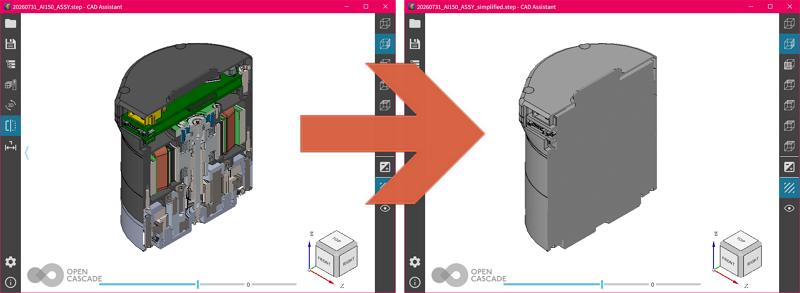
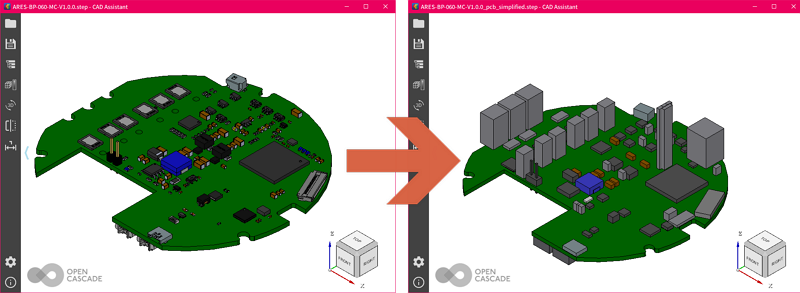
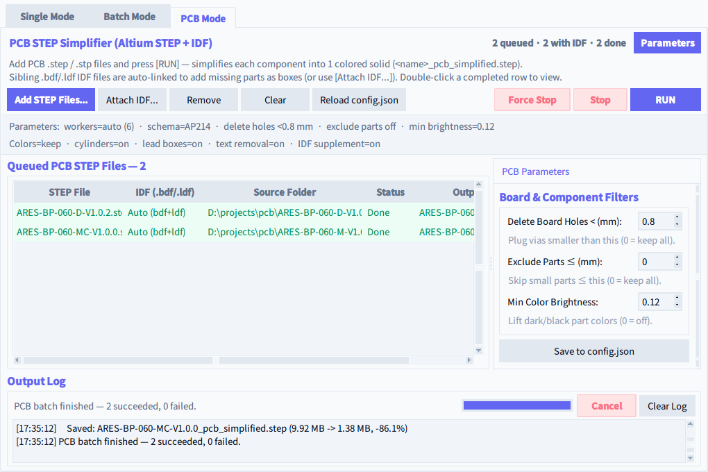

# SIMPLE 3D STEP

> **Language:** **English** | [한국어 (README_KO.md)](README_KO.md)
>
> **Supported Operating Systems:** **Microsoft Windows (64-bit)** · **Linux (64-bit)** (GUI & Headless CLI)

A desktop and CLI tool for simplifying complex 3D STEP assemblies — both **mechanical enclosures** (into a single watertight Solid Body STEP with automatic internal IP removal) and **complex Altium PCB assemblies** (into a lightweight colored per-component single-solid STEP with optional IDF `.bdf`/`.ldf` missing-part supplementation). For mechanical assemblies, it **automatically identifies and removes non-visible internal parts**, **preserves 100% of the original exterior B-Rep CAD geometry** (planes, cylinders, cones, tori, fillets, cooling fins, mounting holes), fills internal cavities with an exact analytic B-Rep core, and purges closed internal void shells for clean cross-section / clipping-plane rendering across CAD kernels.

## What It Does — Before & After

### Mechanical Assembly Simplification (Single / Batch Mode)



> **Left (`Original Assembly STEP`) → Right (`Simplified Single Solid STEP`)** shown with a live cross-section clipping plane:
> - **Automatic Internal IP Removal**: Hidden internal components (PCBs, stator coils, magnets, bearings, shafts, planetary gears, internal screws) are automatically detected and stripped so proprietary internal designs are never exposed.
> - **100% Exact Exterior CAD Preservation**: Every external B-Rep surface (housing cylinders, chamfers, mounting features, external connector ports) stays geometrically exact — zero triangle/voxel distortion.
> - **Completely Filled Single Solid Body**: All internal cavities and void shells are eliminated into one strict 2-manifold Solid Body (`Solid 1 / Shell 1`) that opens cleanly as a solid with proper cross-section capping in **SolidWorks**, **eDrawings**, **FreeCAD**, and **OpenCASCADE CAD Assistant** — while drastically reducing STEP file size (typically **85–95% smaller**).

### PCB Assembly Simplification (PCB Mode — Altium STEP + IDF)



> **Left (`Original Altium PCB STEP`) → Right (`Simplified PCB STEP + IDF`)**:
> - **Per-Component Single-Solid Reduction**: Instead of dropping internal parts, every PCB component (ICs, connectors, inductors, capacitors, SMDs) is simplified into **1 watertight Solid** — fusing IC bodies, heatsinks, and grouped lead/pin banks into clean analytic prisms, simplifying electrolytic capacitors and round cans into exact **cylinders**, removing engraved/embossed text features, and keeping the PCB substrate outline and mounting holes (`≥ min_board_hole_mm`, default `0.8 mm`).
> - **Color Preservation, Brightness Lift & Full Naming**: Preserves each component's representative main-body RGB color (automatically brightening pitch-black/overly dark housings for clear visual inspection), keeps both **RefDes** and **leaf part name** in a 2-level Altium XCAF hierarchy, and applies XCAF prototype instancing to shrink complex PCB STEP files dramatically (**up to ~85–90% smaller**).
> - **Altium IDF (`.bdf` / `.ldf`) Missing-Part Supplementation**: Automatically pairs sibling `.bdf`/`.ldf` files to detect components omitted from the STEP export and adds them as accurately positioned, rotated rectangular boxes — while never overwriting parts already present in the STEP file.

---

## GUI Overview

The application runs as a high-density single window (`1020×680` default, automatically scaled to the active UI font with zero widget clipping) using a clean **Slate + Indigo (Premium Light)** theme with three tabs — **Single Mode** for the interactive 4-step workflow, **Batch Mode** for parallel multi-file mechanical solidification, and **PCB Mode** for parallel Altium PCB STEP + IDF simplification. Switch tabs at any time from the top of the window.

### Single Mode — Interactive 4-Step Workflow


Primary workflow buttons (**Open STEP → 1. Analyze Parts → 2. Convert to Solid → Save Result**) are emphasized in Indigo blue and turn green `✔` as each step completes, while **Cancel** actions use a red danger style. External parts are kept and hidden internal parts are highlighted in soft rose (`Drop`) in the parts table, the result badge reports the final single-solid validation (`Solid 1 / Shell 1 · Fill +402,124 mm³`), and a compact 3-line light **Output Log** tracks progress at the bottom. The advanced parameter drawer on the right is hidden by default and toggled via **[Parameters]**.

### Batch Mode — Parallel Multi-File Queue


Every queued file shows its status (`Pending` / `Running` / `Done` / `Failed` / `Skipped`), source folder, and output file name. Primary actions (**Add STEP Files...** and **RUN**) are emphasized in Indigo blue, while **Force Stop**, **Stop**, and **Cancel** use the red danger style. **RUN** processes the highlighted rows (or the whole queue when nothing is selected) in parallel across a persistent multi-worker CAD pool (`batch_workers` in `config.json`, `0` = Auto) with automatic per-worker thread budgeting, and the final `Batch finished — N succeeded, M failed` summary is shown in the status bar. **Double-click a completed row** to open its `<name>_simplified.step` in the configured external 3D viewer.

### PCB Mode — Altium PCB STEP + IDF Simplifier



Designed specifically for complex PCB assemblies exported from Altium Designer. Adding `.step` / `.stp` files automatically detects matching `.bdf`/`.ldf` (or `.brd`/`.pro`, `.emn`/`.emp`) IDF files in the same folder, or you can use **[Add IDF...]** (always enabled, even with no STEP file registered) to add standalone IDF-only PCB jobs or manually attach IDF pairs to a STEP row. Toggle **[Parameters]** (top-right, hidden by default just like Single Mode) to adjust **Delete Board Holes < (mm)**, **Exclude Parts ≤ (mm)**, and **Min Color Brightness**, and save them to `config.json`. Pressing **[RUN]** processes the queued PCB STEP and/or IDF-only files in parallel, writing `<name>_pcb_simplified.step` next to each source file; **double-click a completed row** to open it in your 3D viewer.

---

## Key Features

> 📖 **Mathematical & algorithmic background:** [English (docs/theory.md)](docs/theory.md) · [한국어 (docs/theory_ko.md)](docs/theory_ko.md)

### 1. XCAF-Based STEP Assembly Parsing (`STEPCAFControl_Reader`)
- Preserves assembly hierarchy, part names, instance placements (`TopLoc_Location`), volumes, surface areas, face counts, and bounding boxes.
- Safely reads and writes Windows file paths containing non-ASCII / Unicode characters.

### 2. Multi-Core 2-Pass Exterior Visibility Analysis (Intel Embree BVH)
- **Parallel Bucketed Tessellation**: Groups parts into logarithmic deflection buckets and invokes OCCT's native C++ parallel mesher (`BRepMesh_IncrementalMesh` / `OSD_Parallel`) per compound bucket so all CPU cores mesh faces simultaneously, while reusing the resulting mesh downstream during interior core generation.
- **Pass 1 (Outside-In Multi-View Ray Casting)**: Casts orthographic ray grids from Fibonacci sphere viewpoints (default 64 views) concurrently across a `ThreadPoolExecutor` (`nogil` Embree queries) and uses Cauchy integral area estimation to compute triangle-size-independent exposure ratios.
- **Pass 2 (Inside-Out Hemisphere Verification)**: Fires outward hemisphere rays from borderline and small parts in parallel (preserving exact deterministic sampling) so small exterior bolts, connectors, or protrusions are not mistakenly dropped.
- **Manual Override Support**: Search, filter, sort, and double-click or press `Space` in the GUI Parts Table to toggle `Keep` / `Drop` status at any time.

### 3. 100% Exterior-Preserving Exact B-Rep Solidification (No Voxelized Surfaces)
- **Inward Analytic B-Rep Internal Core**: Generates exact analytic cylinders (`MakeCylinder`) and polygonal prisms (`MakePrism`) strictly inside the outer wall safety inset (`core_inset_mm`), using multi-threaded Embree 3-axis occupancy sweeps and 26-direction sky-visibility carving (preventing leakage into cooling fin valleys or external grooves), plus adaptive constant-cross-section slab merging and conservative coaxial cylinder coalescing to minimize internal primitive count.
- **Precision-First Boolean Fuse**: Attempts exact `fuzzy=0.0` parallel multi-tool Boolean union first with volume-preservation checks to protect fine fillets and tangent edges created in SolidWorks, CATIA, or NX, falling back to a spatial-proximity balanced binary-tree fuse ($O(N \log N)$) when exact batch fusion encounters tangent contacts.
- **Complete Closed Internal Void-Shell Purge**: Strips both multi-shell internal cavities (`BRepClass3d.OuterShell_s` + `BRepBuilderAPI_MakeSolid`) and hidden single-shell disconnected cavity components (fast `Face→Edge` indexed adjacency BFS) in a mandatory final post-processing stage, guaranteeing a 100% solid interior with zero hollow pockets when sliced with a clipping plane.
- **Cross-Kernel SolidWorks (Parasolid) & OpenCASCADE CAD Assistant Compatibility**: Enforces strict 2-manifold solid topology and Parasolid precision (`>= 1e-5 mm`) by automatically resolving `TopAbs_INTERNAL` Boolean tangency slits (targeted ultra-tight `5e-5`–`1e-4` fuzzy retry), healing non-manifold zero-thickness edges and pinched vertices with microscopic analytic beads (`r = 0.05 mm`), collapsing sub-precision micro-edges (`< 5e-5 mm`), capping STEP `UNCERTAINTY` below half the shortest edge length (`1e-5`–`1e-3`), splitting periodic surfaces (`ShapeUpgrade_ShapeDivideClosed`), applying tolerance-guarded sliver cleanup (`ShapeFix_FixSmallFace`), zero-distortion curved-edge splitting, automatic **tangent pinch-wire hole splitting**, and parallel `BRepCheck_Analyzer` validation so SolidWorks, eDrawings, FreeCAD, and OpenCASCADE CAD Assistant (OCCT 7.x) all import and cap the result cleanly as a Solid Body.
- **Floating Exterior Part Bridging & Same-Domain Unification**: Connects tolerance-gapped exterior parts (connectors, fasteners) via hidden internal B-Rep pins found with multi-threaded `cKDTree(workers=-1)` queries and merges coplanar/co-surface faces with `ShapeUpgrade_UnifySameDomain`.

### 4. Altium PCB STEP + IDF Simplification Engine (`PCB Mode`)
- **PCB Substrate Cleanup**: Automatically identifies the PCB board solid, preserves its exact outer contour and mounting holes (`≥ pcb_min_board_hole_mm`, default `0.8 mm`), and plugs tiny via holes (`BRepAlgoAPI_Defeaturing`) + unifies coplanar faces.
- **Per-Component 1-Solid Reduction**:
  - **IC Chips & Connectors**: Groups peripheral lead/pin arrays into clean side-bank rectangular prisms, fuses main body + heatsink/thermal tabs + lead banks via overlap-guarded `BRepAlgoAPI_Fuse` + `ShapeUpgrade_UnifySameDomain` into 1 watertight solid.
  - **Cylindrical Parts**: Detects electrolytic capacitors, radial cans, and round inductors via cylindrical surface coverage and volume ratios, replacing them with exact `BRepPrimAPI_MakeCylinder` solids (fusing a simple square base box for SMD cans with wide base flanges).
  - **Engraved/Embossed Text Removal & Arbitrary-Angle OBB**: Drops tiny surface text/logo solids and computes exact full-vertex 2D Convex Hull Rotating Calipers OBBs so rotated connectors/components (e.g., 45° / 115°) stay tightly fitted in their exact original pose.
  - **Optional Small-Part Filtering**: Excludes non-board components with max dimension `≤ pcb_exclude_small_part_mm` when configured.
- **Color Preservation, Brightness Lift & 2-Level XCAF Naming**: Extracts area-weighted main-body RGB colors, lifts overly dark/pitch-black housings to a readable luminance floor (`pcb_min_color_brightness`, default `0.12`), preserves Altium's 2-level `RefDes → Leaf Part Name` hierarchy, and shares XCAF prototype solids across repeated SMDs for high compression (`AP214` / `AP242`).
- **Altium IDF (`.bdf` / `.ldf`) Missing-Part Supplementation**: Parses IDF 2.0/3.0 (`MM`/`THOU`, `TOP`/`BOTTOM`), aligns board coordinates via median-residual refinement, strictly preserves all STEP-existing components by `RefDes` + spatial check, and adds only genuinely missing components as rotated boxes.

### 5. Freeze-Free Slate + Indigo GUI (`tkinter` / `ttk`) & Multi-Core Batch Pool
- **Unified High-Density Slate + Indigo Theme**: DPI-aware `Segoe UI` typography, light Slate-50/100 surfaces, Indigo-500 primary action buttons, Rose-500 stop/cancel controls, and font-aware auto-sized geometry (`1020×680` default) preventing widget clipping at any UI font size.
- **Three Mode Tabs in One Window**: **Single Mode** (interactive 4-step workflow), **Batch Mode** (parallel multi-file mechanical solidification), and **PCB Mode** (parallel Altium PCB STEP + IDF simplification) switch instantly, each with independent background CAD worker pools.
- **Dedicated Background CAD Process(es) (`multiprocessing`)**: Heavy OpenCASCADE C++ operations run in persistent worker process(es) so the GUI window never freezes (`Not Responding`). Batch Mode spawns a configurable pool of parallel workers (`batch_workers` in `config.json`, `0` = Auto) with per-worker `OSD_ThreadPool` and Embree thread budgeting to prevent core oversubscription.
- **Live Busy Status Banner**: Displays an animated spinner, live elapsed timer, continuous pulse progress bar, and two-stage red `Cancel / Force Stop` controls while updating the window title with elapsed time.
- **Bold 4-Step Workflow Bar with State Feedback**: `Open STEP › 1. Analyze Parts › 2. Convert to Solid › Save Result` are highlighted in bold Indigo blue and automatically transition between idle, running (`●`), and completed (emerald `✔`) states; manual part edits automatically reset downstream steps.
- **Clean Compact Layout**: The right-side advanced parameters drawer is hidden by default and can be toggled on demand via the **[Parameters]** toolbar button.
- **External 3D Viewer Integration**: Configure any installed 3D CAD viewer in `config.json` or **[Viewer Settings]** to open the **Original STEP**, **Kept Parts Preview**, or **Final Result STEP** with one click.

---

## Supported Operating Systems & Requirements

### Supported Operating Systems

| Operating System | Architecture | Modes Supported | Launcher Script | Default Config Template |
| :--- | :---: | :--- | :--- | :--- |
| **Microsoft Windows** (Windows 10 / 11) | 64-bit (`x86_64`) | Desktop GUI (Single / Batch / PCB) & CLI | `run_simple_3d_step.bat` | `config.json.win` |
| **Linux** (Ubuntu, Fedora, Debian, etc.) | 64-bit (`x86_64`) | Desktop GUI (Single / Batch / PCB, X11/Wayland) & Headless CLI | `run_simple_3d_step.sh` | `config.json.linux` |

### Requirements & Installation

- **Python**: 3.13+ (managed with [uv](https://docs.astral.sh/uv/))
- **Core Libraries**: `cadquery-ocp-novtk` (OCCT 8.x), `trimesh`, `embreex` (Intel Embree), `rtree`, `numpy`, `scipy`, `scikit-image` (2D internal core contour extraction)
- **Recommended External 3D Viewer (optional, installed separately)**: [OpenCASCADE CAD Assistant](https://opencascade.com/products/cad-assistant/) (`https://opencascade.com/products/cad-assistant/`) — free cross-platform STEP viewer for Windows and Linux built on the OpenCASCADE kernel, ideal for inspecting kept parts and verifying solid cross-sections with clipping planes.

```bash
# Sync dependencies
uv sync
```

---

## Usage

### 1. Launch via Launcher Script (Windows & Linux)
- **Windows (`run_simple_3d_step.bat`)**:
  - **Double-click** `run_simple_3d_step.bat` in File Explorer to launch the unified GUI without a console window.
  - **Drag and drop** a single `.step` / `.stp` file onto `run_simple_3d_step.bat` to open it immediately in **Single Mode**.
  - **Drag and drop several** STEP files at once to open the **Batch Mode** tab with all of them queued.
- **Linux (`run_simple_3d_step.sh`)**:
  ```bash
  ./run_simple_3d_step.sh                        # Single Mode GUI
  ./run_simple_3d_step.sh --batch                # Batch Mode GUI
  ./run_simple_3d_step.sh --pcb                  # PCB Mode GUI
  ./run_simple_3d_step.sh path/to/assembly.step  # Open directly in Single Mode
  ./run_simple_3d_step.sh a.step b.step          # Open Batch Mode with files queued
  ./run_simple_3d_step.sh --cli -i model.step    # Headless CLI mode
  ```
- On first run, if `.venv` does not exist yet, `uv sync` is executed automatically.

### 2. Launch GUI from Command Line
```powershell
uv run simple-3d-step                 # Single Mode tab
uv run simple-3d-step --batch         # Batch Mode tab
uv run simple-3d-step --pcb           # PCB Mode tab (Altium STEP + IDF)
uv run simple-3d-step --pcb a.step b.step  # PCB Mode with files pre-queued
uv run simple-3d-step path\to\assembly.step
uv run simple-3d-step a.step b.step   # opens Batch Mode with both queued
```

### 3. CLI Batch Mode
```powershell
# Single-file run (writes *_simplified.step next to the input file)
uv run simple-3d-step --cli -i assembly.step -o assembly_simplified.step

# Multi-file parallel batch run (-j 0 = Auto worker pool, or specify -j 4)
uv run simple-3d-step --cli a.step b.step c.step d.step -j 4

# Show all CLI options
run_simple_3d_step.bat --help
```

| CLI Option | Default | Description |
| :--- | :---: | :--- |
| `--views` | `64` | Number of Fibonacci sphere viewpoints (Fast: 26, Standard: 64, Fine: 162) |
| `--grid` | `160` | Orthographic ray grid resolution per viewpoint |
| `--min-visible` | `0.5` | Minimum visibility threshold to classify a part as exterior (`%`) |
| `--bridge-gap` | `3.5` | Internal core bridging gap across rotor/cover clearances (`mm`) |
| `--core-inset` | `2.0` | Minimum inward safety inset protecting exterior B-Rep surfaces (`mm`) |
| `--island-gap` | `3.0` | Maximum gap for hidden internal pin bridging of floating parts (`mm`) |
| `--remove-holes` | `False` | Enable automatic plugging of small cylindrical through-holes |
| `--max-hole-dia` | `10.0` | Maximum hole diameter plugged when `--remove-holes` is enabled (`mm`) |
| `--no-core` / `--no-unify` | `False` | Disable internal core filling / same-domain face unification |
| `--schema` | `AP214` | Output STEP schema (`AP214`, `AP242`, `AP203`) |
| `-j`, `--jobs` | `0` | Parallel worker processes for multi-file CLI batch (`0` = Auto) |

### 4. Mode Tabs — Single Mode / Batch Mode / PCB Mode

The GUI has three tabs, switchable at any time from the top of the window (see the screenshots in [GUI Overview](#gui-overview)):

**Single Mode** — the interactive 4-step workflow described below (open one assembly, inspect the parts table, preview, convert, save).

**Batch Mode** — a multi-file parallel queue for mechanical single-solid simplification driven by `config.json`:

- **[Add STEP Files...]** (`Ctrl+O`) selects several `.step` / `.stp` files at once (multi-select), and **[Remove Selected]** / **[Clear List]** curate the queue.
- Press **[RUN]** (`F5`): every queued file — or only the highlighted rows, when a selection exists — is simplified **in parallel** across a persistent CAD worker pool (`batch_workers` in `config.json`, `0` = Auto) with the parameters from `config.json` (re-read on every RUN).
- Each simplified model is written **next to its own source file** as `<name>_simplified.step`.
- **[Stop]** (`Esc`) cancels all active files and skips the rest; **[Force Stop]** immediately kills and restarts active background CAD workers if a C++ step is stuck.

**PCB Mode** — a multi-file parallel queue tailored for Altium Designer PCB STEP + IDF files:

- **[Add STEP Files...]** (`Ctrl+O`) queues multiple PCB `.step` / `.stp` files and automatically links sibling `.bdf` / `.ldf` (plus `.brd`/`.pro`, `.emn`/`.emp`) IDF files when present. Use **[Add IDF...]** to queue standalone IDF-only PCB models (without a STEP file) or attach IDF files to an unlinked STEP row, or right-click a row to attach/change/clear IDF files manually.
- Toggle **[Parameters]** (top-right) to show or hide the right-hand **PCB Parameters** panel (`Delete Board Holes < (mm)`, `Exclude Parts ≤ (mm)`, `Min Color Brightness`, and **Save to config.json**).
- Press **[RUN]** (`F5`) to process the selected rows (or all queued files) in parallel; each output is saved next to its source as `<name>_pcb_simplified.step`. Double-click a completed row to open it in the configured external 3D viewer.
- Tab labels show live progress (`● Batch Mode (2/5)`, `● PCB Mode (1/2)`) even while working in another tab; each mode uses its own independent background CAD worker pool.

---

## Standard GUI Workflow (Single Mode)

1. **[Open STEP]** (`Ctrl+O`): Load a 3D STEP assembly containing internal parts.
2. **[1. Analyze Parts]**: Automatically identify non-visible internal parts and mark them as `Drop`.
   - Optionally double-click or press `Space` in the parts list to override `Keep` / `Drop`, then click **[Preview Kept Parts]** to inspect them in your external 3D viewer.
3. **[2. Convert to Solid]**: Fill internal cavities, purge closed void shells, and fuse kept exterior parts into a single watertight B-Rep Solid.
4. **[Open Result]** / **[Save Result]** (`Ctrl+S`): Inspect the output in your external 3D viewer or save it to the source STEP directory (default `*_simplified.step`).

---

## External 3D Viewer & GUI Font Configuration (`config.json`)

> **Automatic OS Default Initialization:** On startup, if `config.json` does not exist yet, the application automatically copies the OS-specific template — `config.json.win` on **Microsoft Windows** or `config.json.linux` on **Linux** — to `config.json` and applies it immediately.

> **Recommended External 3D Viewer:** For viewing original STEP assemblies, kept-part previews, and simplified solid outputs (including cross-section / clipping-plane inspection), we recommend installing **[OpenCASCADE CAD Assistant](https://opencascade.com/products/cad-assistant/)** (`https://opencascade.com/products/cad-assistant/`), which is free and available on both Windows and Linux:
> - **Windows default path**: `C:/Program Files/CAD Assistant/CADAssistant.exe`
> - **Linux default path**: `/usr/bin/cadassistant` (or `cadassistant` on `PATH`)

Configure your preferred external 3D viewer and GUI font (`ui_font_family`, `ui_font_size`) in `config.json` (project root) or via **[Settings]** in the GUI. Leaving `viewer_executable` empty opens STEP files with the system default file association (Windows default application / Linux `xdg-open`). On Linux, you may specify either an absolute path (e.g. `"/usr/bin/cadassistant"`) or a command on `PATH` (e.g. `"cadassistant"`). Font changes apply immediately without restarting; leaving `ui_font_family` empty uses the automatic OS default (`Segoe UI` on Windows, `Noto Sans` / `DejaVu Sans` on Linux).

```json
{
  "viewer_executable": "C:/Program Files/CAD Assistant/CADAssistant.exe",
  "viewer_args": "{file}",
  "ui_font_family": "",
  "ui_font_size": 9,
  "num_views": 162,
  "grid_resolution": 200,
  "min_visible_ratio_pct": 0.5,
  "fill_internal_core": true,
  "core_bridge_gap_mm": 3.5,
  "core_inset_mm": 2.0,
  "connect_floating_parts": true,
  "max_island_gap_mm": 3.0,
  "remove_small_holes": false,
  "unify_same_domain": true,
  "step_schema": "AP214",
  "batch_workers": 0,
  "pcb_simplify_leads": true,
  "pcb_detect_cylinders": true,
  "pcb_cylinder_circularity_min": 0.8,
  "pcb_remove_text_features": true,
  "pcb_small_part_box_mm": 4.0,
  "pcb_preserve_colors": true,
  "pcb_use_idf_supplement": true,
  "pcb_keep_board_holes": true,
  "pcb_min_board_hole_mm": 0.8,
  "pcb_exclude_small_part_mm": 0.0,
  "pcb_min_color_brightness": 0.12,
  "pcb_idf_default_color": [0.35, 0.35, 0.38]
}
```

> `batch_workers: 0` selects the worker pool size automatically from the system's CPU cores (capped at 6 workers to balance throughput and per-worker RAM, with automatic per-worker thread budgeting); set `1` for strictly sequential batch execution or any explicit count `N`.

---

## Project Structure

```text
SIMPLE_3D_STEP/
├── README.md                        # English documentation
├── README_KO.md                     # Korean documentation
├── config.json                      # Active configuration (auto-copied from .win / .linux if missing)
├── config.json.win                  # Default configuration template for Microsoft Windows
├── config.json.linux                # Default configuration template for Linux
├── pyproject.toml                   # uv project metadata and dependencies
├── run_simple_3d_step.bat           # Windows launcher (Single/Batch tabbed GUI, drag-and-drop, CLI)
├── run_simple_3d_step.sh            # Linux/POSIX launcher (auto uv sync, GUI & headless CLI)
├── docs/
│   ├── screenshots/                 # README screenshots (function, function_pcb, Single/Batch/PCB GUI)
│   ├── theory.md                    # Key Features expanded into math & algorithms (English)
│   └── theory_ko.md                 # Same document in Korean
├── src/simple_3d_step/
│   ├── main.py                      # GUI and CLI entry point (--batch, --pcb, --cli)
│   ├── config.py                    # config.json persistence and external viewer launcher
│   ├── models.py                    # Assembly, visibility, solidification, and PCB data models
│   ├── core/
│   │   ├── occt_compat.py           # OCCT 7.x / 8.x compat, parallel runtime config & BinTools IPC
│   │   ├── step_io.py               # XCAF STEP reader/writer (single-solid & colored 2-level PCB XCAF)
│   │   ├── idf_parser.py            # Altium IDF 2.0/3.0 (.bdf/.ldf) parser, alignment & missing-part boxes
│   │   ├── pcb_simplifier.py        # Per-component PCB 1-solid engine (cylinders, lead banks, OBB, color lift)
│   │   ├── tessellation.py          # Parallel bucketed OCCT -> trimesh tessellation & subset reuse
│   │   ├── visibility.py            # Multi-threaded Intel Embree 2-Pass exterior visibility engine
│   │   ├── solidifier.py            # Exterior-preserving exact B-Rep solidification & void-shell purge engine
│   │   ├── validator.py             # Parallel BRepCheck_Analyzer and analytic surface verification
│   │   └── worker.py                # Persistent multiprocessing CAD worker with thread budgeting
│   └── gui/
│       ├── theme.py                 # Slate + Indigo (Premium Light, DPI-aware) design tokens & ttk theme
│       ├── app.py                   # Unified window: Single/Batch/PCB mode tabs + auto-sized geometry
│       ├── batch_panel.py           # Batch mode tab (multi-worker parallel RUN, config.json driven)
│       ├── pcb_panel.py             # PCB mode tab (Altium STEP + IDF queue & collapsible PCB Parameters)
│       ├── part_tree.py             # Assembly parts table (search/filter/sort/manual toggle)
│       ├── control_panel.py         # Collapsible advanced parameters & result summary panel
│       ├── busy_banner.py           # Animated background task banner
│       ├── log_panel.py             # Bottom status bar, progress bar, and 3-line light Output Log
│       └── settings_dialog.py       # External 3D viewer & font settings dialog
└── tests/
    ├── generate_sample_step.py      # Synthetic mechanical STEP assembly generator for tests
    ├── generate_sample_pcb.py       # Synthetic Altium PCB STEP + IDF (.bdf/.ldf) generator for tests
    ├── test_visibility.py           # Internal part detection accuracy tests
    ├── test_solidifier.py           # Exact B-Rep single-solid & void-shell purge tests
    ├── test_idf_parser.py           # IDF 2.0/3.0 parsing, alignment & non-overwrite matching tests
    ├── test_pcb_simplifier.py       # Per-component 1-solid, cylinder, color lift & small-part filter tests
    ├── test_pcb_gui.py              # PCB Mode tab, IDF attachment, collapsible Parameters & RUN tests
    ├── test_multicore.py            # Multi-core Embree determinism, bucket meshing & parallel CLI tests
    ├── test_worker.py               # Non-blocking multiprocessing pipeline tests
    ├── test_gui_layout.py           # Modern Flat layout, bold workflow bar, toggle & save-path tests
    ├── test_batch_gui.py            # Mode tabs, batch config mapping, same-dir output & batch run tests
    └── test_config_and_cli.py       # Config persistence and CLI end-to-end tests
```

---

## Running Tests

```powershell
uv run pytest -v
```
