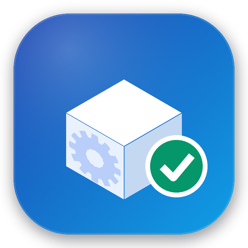
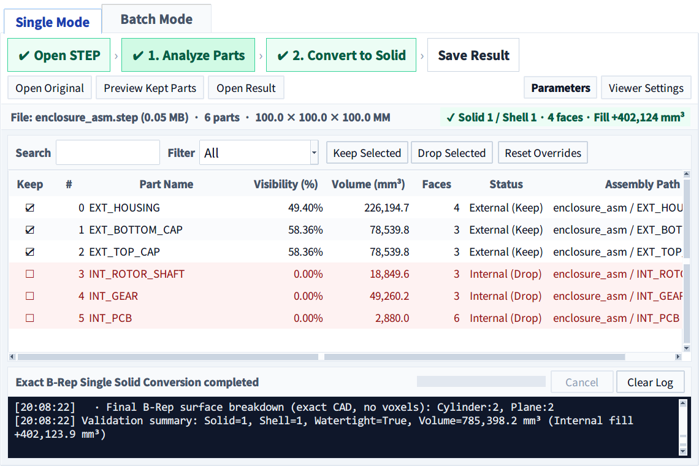
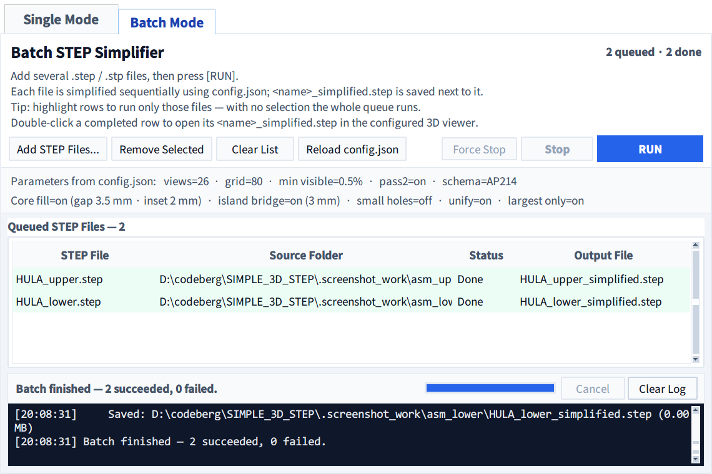

<p align="center">
  
</p>

# SIMPLE 3D STEP

> **Language:** **English** | [한국어 (README_KO.md)](README_KO.md)

A desktop and CLI tool for simplifying complex 3D STEP assemblies (containing internal motor rotors/stators, gears, bearings, PCBs, fasteners, etc.) into a **single watertight Solid Body STEP file**. It **automatically identifies and removes non-visible internal parts**, **preserves 100% of the original exterior B-Rep CAD geometry** (planes, cylinders, cones, tori, fillets, cooling fins, mounting holes), fills internal cavities with an exact analytic B-Rep core, and purges closed internal void shells for clean cross-section / clipping-plane rendering across CAD kernels.

---

## GUI Overview

The application runs as a single window with two tabs — **Single Mode** for the interactive 4-step workflow, and **Batch Mode** for processing many STEP files one after another. Switch tabs at any time from the top of the window.

### Single Mode — Interactive 4-Step Workflow



External parts are kept (green) and hidden internal parts are dropped (red) in the parts table; the workflow buttons turn green `✔` as each step completes, and the result badge reports the final single-solid validation (`Solid 1 / Shell 1 · Fill +402,124 mm³`). The advanced parameter drawer on the right is hidden by default and toggled via **[Parameters]**.

### Batch Mode — Sequential Multi-File Queue



Every queued file shows its status (`Pending` / `Running` / `Done` / `Failed` / `Skipped`), source folder, and output file name. **RUN** processes the highlighted rows (or the whole queue when nothing is selected) sequentially using the parameters in `config.json`, and the final `Batch finished — N succeeded, M failed` summary is shown in the status bar. **Double-click a completed row** to open its `<name>_simplified.step` in the configured external 3D viewer.

### Application Icon

<p align="center">
  
</p>

The icon summarizes the whole tool in one mark: a clean **isometric solid cube** (one watertight body), an **engraved gear** on its front face (the hidden mechanical internals), and an **emerald check badge** (simplification complete). Small sizes (16–32 px) automatically switch to a compact variant without the gear engraving so the cube and check stay legible in the taskbar and file lists. The 512 px master is `docs/images/icon.png`, the window/taskbar icon is `src/simple_3d_step/gui/assets/app.ico` (16–256 px), and both are regenerated with `uv run python tools/make_icon.py`.

---

## Key Features

> 📖 **Mathematical & algorithmic background:** [English (docs/theory.md)](docs/theory.md) · [한국어 (docs/theory_ko.md)](docs/theory_ko.md)

### 1. XCAF-Based STEP Assembly Parsing (`STEPCAFControl_Reader`)
- Preserves assembly hierarchy, part names, instance placements (`TopLoc_Location`), volumes, surface areas, face counts, and bounding boxes.
- Safely reads and writes Windows file paths containing non-ASCII / Unicode characters.

### 2. 2-Pass Exterior Visibility Analysis (Intel Embree BVH)
- **Pass 1 (Outside-In Multi-View Ray Casting)**: Casts orthographic ray grids from Fibonacci sphere viewpoints (default 64 views) and uses Cauchy integral area estimation to compute triangle-size-independent exposure ratios.
- **Pass 2 (Inside-Out Hemisphere Verification)**: Fires outward hemisphere rays from borderline and small parts so small exterior bolts, connectors, or protrusions are not mistakenly dropped.
- **Manual Override Support**: Search, filter, sort, and double-click or press `Space` in the GUI Parts Table to toggle `Keep` / `Drop` status at any time.

### 3. 100% Exterior-Preserving Exact B-Rep Solidification (No Voxelized Surfaces)
- **Inward Analytic B-Rep Internal Core**: Generates exact analytic cylinders (`MakeCylinder`) and polygonal prisms (`MakePrism`) strictly inside the outer wall safety inset (`core_inset_mm`) and protected by 26-direction Embree visibility checks (preventing leakage into cooling fin valleys or external grooves), bridging internal clearances between rotors, covers, and housings.
- **Precision-First Boolean Fuse**: Attempts exact `fuzzy=0.0` Boolean union first with volume-preservation checks to protect fine fillets and tangent edges created in SolidWorks, CATIA, or NX.
- **Complete Closed Internal Void-Shell Purge**: Strips both multi-shell internal cavities (`BRepClass3d.OuterShell_s` + `BRepBuilderAPI_MakeSolid`) and hidden single-shell disconnected cavity components (B-Rep edge-face adjacency BFS) in a mandatory final post-processing stage, guaranteeing a 100% solid interior with zero hollow pockets when sliced with a clipping plane.
- **Cross-Kernel & OpenCASCADE CAD Assistant Compatibility**: Normalizes STEP output with 3D-curve export, clamped precision tolerances (`1e-5`–`1e-3`), `ShapeUpgrade_ShapeDivideClosed` periodic-surface splitting, `ShapeFix_FixSmallFace` micro-sliver cleanup, and zero-distortion curved edge splitting so SolidWorks, eDrawings, FreeCAD, and OpenCASCADE CAD Assistant (OCCT 7.x) all display and cap the result as a solid body.
- **Floating Exterior Part Bridging & Same-Domain Unification**: Connects tolerance-gapped exterior parts (connectors, fasteners) via hidden internal B-Rep pins and merges coplanar/co-surface faces with `ShapeUpgrade_UnifySameDomain`.

### 4. Freeze-Free Modern Flat GUI (`tkinter` / `ttk`)
- **Two Mode Tabs in One Window**: **Single Mode** (interactive 4-step workflow with a parts table) and **Batch Mode** (sequential multi-file queue driven by `config.json`) switch instantly, each with its own background CAD worker so neither blocks the other.
- **Dedicated Background CAD Process (`multiprocessing`)**: Heavy OpenCASCADE C++ operations run in a persistent worker process so the GUI window never freezes (`Not Responding`).
- **Live Busy Status Banner**: Displays an animated spinner, live elapsed timer, continuous pulse progress bar, and two-stage `Cancel / Force Stop` controls while updating the window title with elapsed time.
- **Bold 4-Step Workflow Bar with State Feedback**: `Open STEP › 1. Analyze Parts › 2. Convert to Solid › Save Result` are highlighted in bold and automatically transition between idle, running (blue `●`), and completed (green `✔`) states; manual part edits automatically reset downstream steps.
- **Clean Compact Layout**: The right-side advanced parameters drawer is hidden by default and can be toggled on demand via the **[Parameters]** toolbar button.
- **External 3D Viewer Integration**: Configure any installed 3D CAD viewer in `config.json` or **[Viewer Settings]** to open the **Original STEP**, **Kept Parts Preview**, or **Final Result STEP** with one click.

---

## Requirements & Installation

- **OS**: Windows (64-bit)
- **Python**: 3.13+ (managed with [uv](https://docs.astral.sh/uv/))
- **Core Libraries**: `cadquery-ocp-novtk` (OCCT 8.x), `trimesh`, `embreex` (Intel Embree), `rtree`, `numpy`, `scipy`, `scikit-image` (2D internal core contour extraction)

```powershell
# Sync dependencies
uv sync
```

---

## Usage

### 1. Launch via Batch File (Recommended on Windows)
- **Double-click** `run_simple_3d_step.bat` in File Explorer to launch the unified GUI without a console window.
- **Drag and drop** a single `.step` / `.stp` file onto `run_simple_3d_step.bat` to open it immediately in **Single Mode**.
- **Drag and drop several** STEP files at once to open the **Batch Mode** tab with all of them queued.
- On first run, if `.venv` does not exist yet, `uv sync` is executed automatically.

### 2. Launch GUI from Command Line
```powershell
uv run simple-3d-step                 # Single Mode tab
uv run simple-3d-step --batch         # Batch Mode tab
uv run simple-3d-step path\to\assembly.step
uv run simple-3d-step a.step b.step   # opens Batch Mode with both queued
```

### 3. CLI Batch Mode
```powershell
# Default run (writes *_simplified.step next to the input file)
uv run simple-3d-step --cli -i assembly.step -o assembly_simplified.step

# Show all CLI options
run_simple_3d_step.bat --help
```

| CLI Option | Default | Description |
| :--- | :---: | :--- |
| `--views` | `64` | Number of Fibonacci sphere viewpoints (Fast: 26, Standard: 64, Fine: 162) |
| `--grid` | `160` | Orthographic ray grid resolution per viewpoint |
| `--min-visible` | `0.5` | Minimum visibility threshold to classify a part as exterior (`%`) |
| `--bridge-gap` | `3.5` | Internal core bridging gap across rotor/cover clearances (`mm`) |
| `--core-inset` | `2.0` | Minimum inward safety inset protecting exterior B-Rep surfaces (`mm`) |
| `--island-gap` | `3.0` | Maximum gap for hidden internal pin bridging of floating parts (`mm`) |
| `--remove-holes` | `False` | Enable automatic plugging of small cylindrical through-holes |
| `--max-hole-dia` | `10.0` | Maximum hole diameter plugged when `--remove-holes` is enabled (`mm`) |
| `--no-core` / `--no-unify` | `False` | Disable internal core filling / same-domain face unification |
| `--schema` | `AP214` | Output STEP schema (`AP214`, `AP242`, `AP203`) |

### 4. Mode Tabs — Single Mode / Batch Mode

The GUI has two tabs, switchable at any time from the top of the window (see the screenshots in [GUI Overview](#gui-overview)):

**Single Mode** — the interactive 4-step workflow described below (open one assembly, inspect the parts table, preview, convert, save).

**Batch Mode** — a multi-file queue driven entirely by `config.json`:

- **[Add STEP Files...]** (`Ctrl+O`) selects several `.step` / `.stp` files at once (multi-select), and **[Remove Selected]** / **[Clear List]** curate the queue.
- Press **[RUN]** (`F5`): every queued file — or only the highlighted rows, when a selection exists — is simplified **sequentially** with the parameters from `config.json` (re-read on every RUN).
- Each simplified model is written **next to its own source file** as `<name>_simplified.step`.
- **[Stop]** (`Esc`) cancels the current file and skips the rest; **[Force Stop]** immediately kills and restarts the background CAD worker if a C++ step is stuck.
- The Batch tab label shows live progress (`● Batch Mode (2/5)`) even while you work in Single Mode; each mode uses its own background CAD worker, so the two never block each other.

---

## Standard GUI Workflow (Single Mode)

1. **[Open STEP]** (`Ctrl+O`): Load a 3D STEP assembly containing internal parts.
2. **[1. Analyze Parts]**: Automatically identify non-visible internal parts and mark them as `Drop`.
   - Optionally double-click or press `Space` in the parts list to override `Keep` / `Drop`, then click **[Preview Kept Parts]** to inspect them in your external 3D viewer.
3. **[2. Convert to Solid]**: Fill internal cavities, purge closed void shells, and fuse kept exterior parts into a single watertight B-Rep Solid.
4. **[Open Result]** / **[Save Result]** (`Ctrl+S`): Inspect the output in your external 3D viewer or save it to the source STEP directory (default `*_simplified.step`).

---

## External 3D Viewer Configuration (`config.json`)

Configure your preferred external 3D viewer in `config.json` (project root) or via **[Viewer Settings]** in the GUI. Leaving `viewer_executable` empty opens STEP files with the default Windows file association.

```json
{
  "viewer_executable": "C:\\Program Files\\FreeCAD 1.0\\bin\\freecad.exe",
  "viewer_args": "{file}",
  "num_views": 64,
  "grid_resolution": 160,
  "min_visible_ratio_pct": 0.5,
  "fill_internal_core": true,
  "core_bridge_gap_mm": 3.5,
  "core_inset_mm": 2.0,
  "connect_floating_parts": true,
  "max_island_gap_mm": 3.0,
  "remove_small_holes": false,
  "unify_same_domain": true,
  "step_schema": "AP214"
}
```

---

## Project Structure

```text
SIMPLE_3D_STEP/
├── README.md                        # English documentation
├── README_KO.md                     # Korean documentation
├── config.json                      # External 3D viewer path and default parameters
├── pyproject.toml                   # uv project metadata and dependencies
├── run_simple_3d_step.bat           # Windows launcher (Single/Batch tabbed GUI, drag-and-drop, CLI)
├── docs/
│   ├── images/                      # Application icon (512 px master + size preview sheet)
│   ├── screenshots/                 # README GUI screenshots (Single Mode / Batch Mode)
│   ├── theory.md                    # Key Features expanded into math & algorithms (English)
│   └── theory_ko.md                 # Same document in Korean
├── tools/
│   └── make_icon.py                 # Regenerates docs/images/*.png and gui/assets/app.ico
├── src/simple_3d_step/
│   ├── main.py                      # GUI and CLI entry point
│   ├── config.py                    # config.json persistence and external viewer launcher
│   ├── models.py                    # Part, analysis, solidification, and validation models
│   ├── core/
│   │   ├── occt_compat.py           # OCCT 7.x / 8.x compatibility wrapper
│   │   ├── step_io.py               # XCAF STEP reader and normalized STEP writer
│   │   ├── tessellation.py          # OCCT -> trimesh tessellation with part/face mapping
│   │   ├── visibility.py            # Intel Embree 2-Pass exterior visibility engine
│   │   ├── solidifier.py            # Exterior-preserving exact B-Rep solidification & void-shell purge engine
│   │   ├── validator.py             # BRepCheck_Analyzer and analytic surface verification
│   │   └── worker.py                # Persistent multiprocessing CAD worker (non-blocking GUI)
│   └── gui/
│       ├── theme.py                 # Modern Flat (Slate & Cobalt) design tokens & ttk theme
│       ├── app.py                   # Unified window: Single/Batch mode tabs + 4-step workflow
│       ├── batch_panel.py           # Batch mode tab (multi-file sequential RUN, config.json driven)
│       ├── part_tree.py             # Assembly parts table (search/filter/sort/manual toggle)
│       ├── control_panel.py         # Collapsible advanced parameters & result summary panel
│       ├── busy_banner.py           # Animated background task banner
│       ├── log_panel.py             # Bottom status bar, progress bar, and log console
│       └── settings_dialog.py       # External 3D viewer settings dialog
└── tests/
    ├── generate_sample_step.py      # Synthetic STEP assembly generator for automated tests
    ├── test_visibility.py           # Internal part detection accuracy tests
    ├── test_solidifier.py           # Exact B-Rep single-solid & void-shell purge tests
    ├── test_worker.py               # Non-blocking multiprocessing pipeline tests
    ├── test_gui_layout.py           # Modern Flat layout, bold workflow bar, toggle & save-path tests
    ├── test_batch_gui.py            # Mode tabs, batch config mapping, same-dir output & sequential run tests
    └── test_config_and_cli.py       # Config persistence and CLI end-to-end tests
```

---

## Running Tests

```powershell
uv run pytest -v
```
