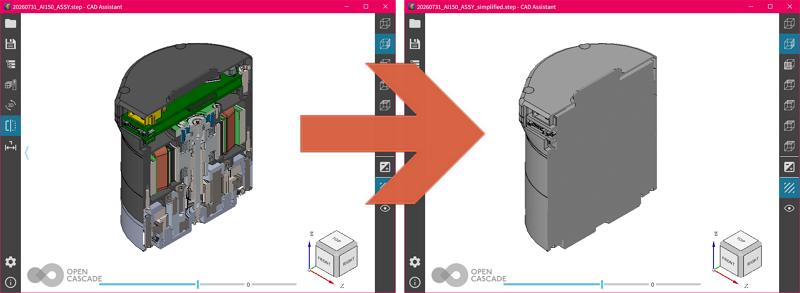
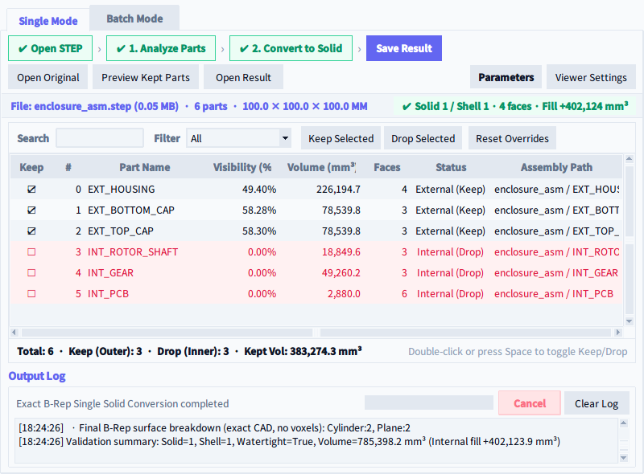
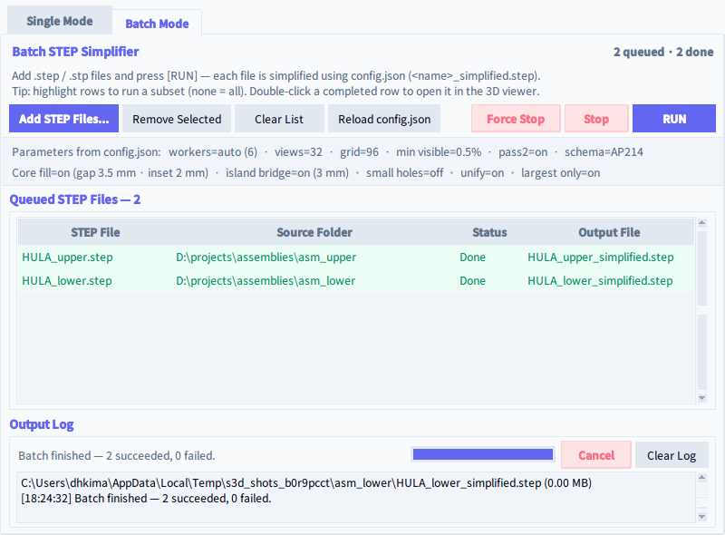

# SIMPLE 3D STEP

> **Language:** [English (README.md)](README.md) | **한국어**
>
> **지원 운영체제:** **Microsoft Windows (64-bit)** · **Linux (64-bit)** (GUI 및 헤드리스 CLI)

내부 부품(모터 로터·스테이터, 기어, 베어링, PCB, 내부 체결부품 등)까지 모두 포함된 복잡한 3D STEP 어셈블리 파일을 **단일 Watertight Solid Body STEP 파일**로 단순화하는 데스크톱/CLI 도구입니다. **외부에서 보이지 않는 내부 부품을 자동 식별·삭제**하고, **외관 B-Rep CAD 형상(평면·원통·원추·토러스·필렛·방열핀·체결홀 등)을 100% 원본 그대로 보존**한 채 해석적 B-Rep 코어로 내부 빈 공간을 채우고 밀폐 내부 공동(Closed Void Shell)을 완전 제거하여, 다양한 CAD 커널의 단면(Clipping Plane) 뷰에서도 속이 꽉 찬 솔리드로 표시되도록 변환합니다.

## 핵심 기능 한눈에 보기 (변환 전 / 후)



> **왼쪽 (`원본 어셈블리 STEP`) → 오른쪽 (`단순화 단일 Solid STEP`)** 단면 절단(Clipping Plane) 비교:
> - **내부 설계 기밀 자동 보호 (IP Protection)**: 외부에서 보이지 않는 내부 부품(PCB, 모터 권선·코일, 마그넷, 베어링, 샤프트, 기어, 내부 볼트 등)을 자동 판별·제거하여 외부 공유 시 내부 구조 유출을 원천 차단합니다.
> - **외관 B-Rep CAD 형상 100% 원본 보존**: 하우징 외경, 모따기, 체결부, 외부 커넥터 포트 등 모든 외관 곡면을 삼각 메쉬/복셀 왜곡 없이 정확한 해석적 B-Rep 곡면 그대로 유지합니다.
> - **속이 완전히 꽉 찬 단일 Solid Body & 대폭 경량화**: 모든 내부 빈 공간과 폐쇄 공동을 제거한 엄격한 2-매니폴드 단일 솔리드(`Solid 1 / Shell 1`)를 생성하여 **SolidWorks**, **eDrawings**, **FreeCAD**, **OpenCASCADE CAD Assistant** 모두에서 단면 캡핑까지 정상 Solid로 열리며, STEP 파일 크기도 대폭 줄어듭니다(일반적으로 **85~95% 경량화**).

---

## GUI 화면

**Slate + Indigo (Premium Light)** 테마와 Windows DPI 인식 `Segoe UI` (9–10pt) 폰트를 적용한 컴팩트 고밀도 단일 창(기본 `800×590`)에서 **Single Mode**(대화형 4단계 워크플로우)와 **Batch Mode**(멀티 CPU 코어 기반 다중 STEP 파일 병렬 처리) 탭을 언제든 전환할 수 있습니다.

### Single Mode — 대화형 4단계 워크플로우



상단 4단계 워크플로우 버튼(**Open STEP → 1. Analyze Parts → 2. Convert to Solid → Save Result**)은 파란색(Indigo)으로 강조되며 완료된 단계는 녹색 `✔`로 바뀌고, **Cancel** 버튼은 빨간색(Rose) 스타일로 표시됩니다. 7행 기준의 컴팩트 부품 테이블에서 외관 부품은 유지(Keep), 숨은 내부 부품은 연한 적색(Drop)으로 표시되며, 우측 결과 배지(`Solid 1 / Shell 1 · Fill +402,124 mm³`)와 하단 3행 라이트 **Output Log**로 진행 상태를 한눈에 확인할 수 있습니다. 우측 고급 파라미터 패널은 기본 숨김이며 **[Parameters]** 버튼으로 토글합니다.

### Batch Mode — 다중 파일 병렬 처리



대기 중인 각 파일의 상태(`Pending` / `Running` / `Done` / `Failed` / `Skipped`), 원본 폴더, 출력 파일명이 표시됩니다. 주요 실행 버튼(**Add STEP Files...**, **RUN**)은 파란색(Indigo)으로 강조되고, **Force Stop**, **Stop**, **Cancel** 버튼은 빨간색(Rose) 스타일로 구분됩니다. **[RUN]**을 누르면 선택된 행(선택이 없으면 전체 큐)을 `config.json` 파라미터와 상주형 멀티 워커 CAD 풀(`batch_workers`, `0` = Auto) 및 워커별 스레드 예산 분할로 병렬 처리하고, 상태바에 `Batch finished — N succeeded, M failed` 요약이 표시됩니다. **출력이 생성된 행을 더블클릭**하면 해당 `<파일명>_simplified.step` 파일이 설정된 외부 3D 뷰어로 열립니다.

---

## 주요 특징

> 📖 **수학·알고리즘 배경:** [한국어 (docs/theory_ko.md)](docs/theory_ko.md) · [English (docs/theory.md)](docs/theory.md)

### 1. XCAF 기반 STEP 어셈블리 파싱 (`STEPCAFControl_Reader`)
- 어셈블리 계층 구조, 부품 이름, 인스턴스 위치 변환(`TopLoc_Location`), 부피, 표면적, 면 수, 외형 크기(BBox)를 보존하여 로드합니다.
- 한글/유니코드가 포함된 Windows 파일 경로도 안전하게 읽고 저장합니다.

### 2. 멀티코어 2-Pass 외부 가시성 분석 (Intel Embree BVH)
- **병렬 버킷 테셀레이션**: 부품을 로그 Deflection 버킷별 `TopoDS_Compound`로 묶어 OCCT 네이티브 C++ 병렬 메셔(`BRepMesh_IncrementalMesh` / `OSD_Parallel`)를 일괄 실행해 모든 CPU 코어를 활용하며, 생성된 메시는 이후 내부 코어 생성 단계에서도 재사용합니다.
- **Pass 1 (외부→내부 다방향 Ray Casting)**: Fibonacci 구면 시점(기본 64시점)의 직교 광선 격자를 `ThreadPoolExecutor`(`nogil` Embree 쿼리)로 병렬 투사하고, Cauchy 적분 기하 면적 추정으로 삼각형 크기에 무관한 노출 비율을 계산합니다.
- **Pass 2 (내부→외부 반구 역방향 검증)**: 경계 및 소형 부품 표면에서 외부로 반구 광선을 병렬 발사(결정적 샘플링 유지)해 소형 외부 볼트·커넥터·돌기가 오삭제되지 않도록 검증합니다.
- **수동 조정 지원**: GUI 부품 테이블에서 검색·필터·정렬 및 더블클릭/`Space` 키로 언제든지 `Keep`(유지) ↔ `Drop`(삭제) 상태를 수동 변경할 수 있습니다.

### 3. 100% 외관 원본 보존 정밀 B-Rep 솔리드화 (삼각 복셀 왜곡 없음)
- **외벽 안쪽 해석적 B-Rep 내부 코어**: 외피에서 안전 여백(`core_inset_mm`) 안쪽 영역에 멀티스레드 Embree 3축 점유 스윕과 26방향 하늘 가시성 보호(방열핀 골짜기·외부 홈 유출 방지)를 적용하고, 동일 단면 연속 슬랩 병합 및 보수적 동축 원통 병합으로 불필요한 내부 분할을 줄인 해석적 원통(`MakeCylinder`)·다각 프리즘(`MakePrism`) 코어를 생성합니다.
- **정밀 우선 Boolean Fuse**: `fuzzy=0.0` 병렬 다중 도구 결합을 우선 시도하고 부피 보존 검증을 수행해 SolidWorks·CATIA·NX의 미세 필렛과 탄젠트 엣지 손상을 방지하며, 폴백 시 공간 근접 기반 균형 이진 트리($O(N \log N)$) 병합을 사용합니다.
- **밀폐 내부 공동(Closed Void Shell) 완전 제거**: 최종 후처리 단계에서 다중 쉘 내부 공동(`BRepClass3d.OuterShell_s` + `BRepBuilderAPI_MakeSolid`)뿐만 아니라 단일 쉘 내부에 숨어 있는 비연결 내부 공동 컴포넌트(고속 `Face→Edge` 인덱스 인접 그래프 BFS)까지 모두 소거하여, 단면 절단 시 속이 완전히 꽉 찬 솔리드를 보장합니다.
- **이종 CAD 커널 SolidWorks(Parasolid) 및 OpenCASCADE CAD Assistant 호환성**: 엄격한 2-매니폴드 솔리드 위상과 Parasolid 정밀도(`>= 1e-5 mm`)를 보장하기 위해 Boolean 탄젠트 슬릿(`TopAbs_INTERNAL` 엣지) 자동 감지 및 초정밀 `5e-5`–`1e-4` fuzzy 재시도, 비매니폴드 제로-두께(4면 교차) 엣지 및 핀치 정점의 미세 해석적 비드(`r = 0.05 mm`) 힐링, 정밀도 미만 미세 엣지(`< 5e-5 mm`) 정리, 최단 엣지 길이의 절반 이하로 상한을 맞춘 STEP `UNCERTAINTY` 클램핑(`1e-5`–`1e-3`), `ShapeUpgrade_ShapeDivideClosed` 주기 곡면 분할, 공차 팽창 방지 가드가 적용된 `ShapeFix_FixSmallFace` 슬리버 정리, 무왜곡 곡선 엣지 분할, 자동 **내접 핀치 와이어 홀 분할**, 병렬 `BRepCheck_Analyzer` 검증을 수행하여 SolidWorks, eDrawings, FreeCAD, OpenCASCADE CAD Assistant(OCCT 7.x) 모두에서 깨짐 없이 단면 캡핑까지 정상 Solid Body로 열립니다.
- **공차 분리 외관 부품 연결 및 동일 곡면 통합**: 멀티스레드 `cKDTree(workers=-1)` 탐색으로 미세 공차로 떠 있는 외관 부품(커넥터·볼트 등)을 숨겨진 내부 B-Rep 핀으로 연결하고 `ShapeUpgrade_UnifySameDomain`으로 동일 평면·곡면을 통합합니다.

### 4. 프리징 없는 Slate + Indigo GUI (`tkinter` / `ttk`) 및 멀티코어 배치 풀
- **고밀도 Slate + Indigo 통일 테마**: DPI 인식 `Segoe UI`(9–10pt) 폰트, 밝은 Slate-50/100 배경, Indigo 파란색 주요 실행 버튼, Rose 빨간색 중지·취소 버튼, 컴팩트 `800×590` 창(7행 부품 테이블 + 3행 라이트 Output Log)으로 높은 정보 밀도를 제공합니다.
- **하나의 창에서 두 가지 모드 탭**: **Single Mode**(부품 테이블 기반 대화형 4단계 워크플로우)와 **Batch Mode**(`config.json` 기반 다중 파일 병렬 처리)를 즉시 전환할 수 있으며, 모드별로 독립된 백그라운드 CAD 워커를 사용해 서로 블로킹하지 않습니다.
- **전용 백그라운드 CAD 프로세스 풀 (`multiprocessing`)**: 무거운 OpenCASCADE C++ 연산을 상주형 워커 프로세스(들)에서 처리하므로 GUI 창이 절대 멈추지(`응답 없음`) 않습니다. Batch Mode는 `config.json`의 `batch_workers`(`0` = Auto)에 따라 다중 워커를 병렬 실행하며, 워커별 `OSD_ThreadPool`과 Embree 스레드 예산을 자동 분할해 코어 과구독을 방지합니다.
- **실시간 작업 상태 배너**: 작업 중 회전 스피너, 실시간 경과 타이머, 연속 펄스 진행 바, 빨간색 2단계 `Cancel / Force Stop` 버튼을 표시하며 창 제목에도 경과 시간을 반영합니다.
- **Bold 강조 4단계 워크플로우 바 및 상태 피드백**: `Open STEP › 1. Analyze Parts › 2. Convert to Solid › Save Result` 버튼이 파란색 볼드 스타일로 강조되며 대기 / 실행 중(`●`) / 정상 완료(녹색 `✔`) 상태로 자동 전환됩니다. 부품 선택을 수동 수정하면 하위 단계 상태가 자동 초기화됩니다.
- **깔끔하고 컴팩트한 레이아웃**: 우측 고급 파라미터 패널은 기본 숨김 상태이며 필요할 때만 툴바의 **[Parameters]** 버튼으로 토글해 조정할 수 있습니다.
- **외부 3D 뷰어 연동**: `config.json` 또는 GUI의 **[Viewer Settings]**에서 설치된 외부 3D CAD 뷰어를 지정하면 **원본 STEP**, **유지 부품 미리보기**, **최종 결과 STEP**을 원클릭으로 바로 열 수 있습니다.

---

## 지원 운영체제 및 요구 환경

### 지원 운영체제

| 운영체제 | 아키텍처 | 지원 실행 모드 | 런처 스크립트 | 기본 설정 템플릿 |
| :--- | :---: | :--- | :--- | :--- |
| **Microsoft Windows** (Windows 10 / 11) | 64-bit (`x86_64`) | 데스크톱 GUI (Single / Batch) 및 CLI | `run_simple_3d_step.bat` | `config.json.win` |
| **Linux** (Ubuntu, Fedora, Debian 등) | 64-bit (`x86_64`) | 데스크톱 GUI (X11/Wayland + `tkinter`) 및 헤드리스 CLI | `run_simple_3d_step.sh` | `config.json.linux` |

### 요구 환경 및 설치

- **Python**: 3.13 이상 ([uv](https://docs.astral.sh/uv/) 패키지 매니저 사용)
- **핵심 라이브러리**: `cadquery-ocp-novtk` (OCCT 8.x), `trimesh`, `embreex` (Intel Embree), `rtree`, `numpy`, `scipy`, `scikit-image` (2D 내부 코어 윤곽 추출용)
- **권장 외부 3D 뷰어 (별도 설치, 선택 사항)**: [OpenCASCADE CAD Assistant](https://opencascade.com/products/cad-assistant/) (`https://opencascade.com/products/cad-assistant/`) — Windows와 Linux를 모두 지원하는 무료 OpenCASCADE 기반 STEP 뷰어로, 유지 부품 미리보기 및 단면(Clipping Plane) 솔리드 검증에 권장합니다.

```bash
# 의존성 동기화
uv sync
```

---

## 실행 방법

### 1. 런처 스크립트로 실행 (Windows / Linux 권장)
- **Windows (`run_simple_3d_step.bat`)**:
  - 파일 탐색기에서 `run_simple_3d_step.bat`을 **더블클릭**하면 콘솔 창 없이 통합 GUI가 실행됩니다.
  - `.step` / `.stp` 파일 **1개**를 `run_simple_3d_step.bat` 아이콘 위로 **드래그 앤 드롭**하면 **Single Mode** 탭에서 바로 열립니다.
  - **여러 개**의 STEP 파일을 한꺼번에 드롭하면 **Batch Mode** 탭에 모두 대기 목록으로 추가된 상태로 실행됩니다.
- **Linux (`run_simple_3d_step.sh`)**:
  ```bash
  ./run_simple_3d_step.sh                        # Single Mode GUI 실행
  ./run_simple_3d_step.sh --batch                # Batch Mode GUI 실행
  ./run_simple_3d_step.sh path/to/assembly.step  # Single Mode에서 파일 바로 열기
  ./run_simple_3d_step.sh a.step b.step          # Batch Mode 대기열에 추가하여 실행
  ./run_simple_3d_step.sh --cli -i model.step    # 헤드리스 CLI 모드 실행
  ```
- 최초 실행 시 `.venv` 가상환경이 없으면 자동으로 `uv sync`를 수행합니다.

### 2. 명령줄에서 GUI 실행
```powershell
uv run simple-3d-step                 # Single Mode 탭
uv run simple-3d-step --batch         # Batch Mode 탭
uv run simple-3d-step path\to\assembly.step
uv run simple-3d-step a.step b.step   # Batch Mode 탭에 2개 파일 대기
```

### 3. CLI 배치 모드 실행
```powershell
# 단일 파일 실행 (입력 파일과 같은 폴더에 *_simplified.step 생성)
uv run simple-3d-step --cli -i assembly.step -o assembly_simplified.step

# 다중 파일 병렬 배치 실행 (-j 0 = 자동 워커 풀, 또는 -j 4처럼 명시)
uv run simple-3d-step --cli a.step b.step c.step d.step -j 4

# 전체 CLI 옵션 확인
run_simple_3d_step.bat --help
```

| CLI 옵션 | 기본값 | 설명 |
| :--- | :---: | :--- |
| `--views` | `64` | 가시성 분석 Fibonacci 구면 시점 수 (빠름: 26, 표준: 64, 정밀: 162) |
| `--grid` | `160` | 시점당 직교 광선 격자 해상도 |
| `--min-visible` | `0.5` | 외부 부품 판정 최소 가시성 임계값 (`%`) |
| `--bridge-gap` | `3.5` | 로터·커버 간극을 연결하는 내부 코어 브리지 범위 (`mm`) |
| `--core-inset` | `2.0` | 외관 B-Rep 표면 보호 최소 안전 여백 (`mm`) |
| `--island-gap` | `3.0` | 공차 분리 외관 부품의 숨겨진 내부 핀 연결 최대 간격 (`mm`) |
| `--remove-holes` | `False` | 외관 소구경 원통형 관통홀 자동 막기 활성화 |
| `--max-hole-dia` | `10.0` | `--remove-holes` 사용 시 막을 최대 구멍 직경 (`mm`) |
| `--no-core` / `--no-unify` | `False` | 내부 코어 채움 / 동일 곡면 통합 비활성화 |
| `--schema` | `AP214` | 출력 STEP 스키마 (`AP214`, `AP242`, `AP203`) |
| `-j`, `--jobs` | `0` | 다중 파일 CLI 배치 병렬 워커 프로세스 수 (`0` = 자동) |

### 4. 모드 탭 — Single Mode / Batch Mode

GUI 상단의 탭으로 언제든 두 가지 모드를 전환할 수 있습니다 (화면은 [GUI 화면](#gui-화면) 참고).

**Single Mode** — 아래에 설명된 대화형 4단계 워크플로우 (어셈블리 1개 열기 → 부품 분석 → 변환 → 저장).

**Batch Mode** — `config.json` 파라미터로 동작하는 다중 파일 병렬 대기열:

- **[Add STEP Files...]** (`Ctrl+O`)로 여러 개의 `.step` / `.stp` 파일을 한 번에 선택할 수 있고, **[Remove Selected]** / **[Clear List]**로 목록을 정리합니다.
- **[RUN]** (`F5`)을 누르면 대기 중인 모든 파일(또는 행을 선택한 경우 선택된 파일만)이 `config.json`의 파라미터와 상주형 CAD 워커 풀(`batch_workers`, `0` = Auto)로 **병렬** simplify됩니다. 파라미터는 RUN을 누를 때마다 다시 읽습니다.
- 생성된 결과는 **각 원본 파일과 같은 폴더**에 `<파일명>_simplified.step`으로 저장됩니다.
- **[Stop]** (`Esc`)은 실행 중인 파일들을 취소하고 남은 파일을 건너뛰며, **[Force Stop]**은 C++ 연산이 멈추지 않을 때 활성 백그라운드 CAD 워커를 즉시 종료 후 재시작합니다.
- 배치가 실행 중이면 다른 탭을 보고 있어도 Batch 탭 라벨에 진행 상황(`● Batch Mode (2/5)`)이 표시됩니다. 모드별로 독립된 백그라운드 CAD 워커를 사용하므로 서로 블로킹하지 않습니다.

---

## GUI 기본 사용 흐름 (Single Mode)

1. **[Open STEP]** (`Ctrl+O`): 내부 부품이 포함된 3D STEP 어셈블리 파일을 엽니다.
2. **[1. Analyze Parts]**: 외부에서 보이지 않는 내부 부품을 자동 식별해 `Drop` 대상으로 분류합니다.
   - 필요 시 부품 목록에서 더블클릭 또는 `Space` 키로 `Keep` / `Drop`을 수동 조정하고 **[Preview Kept Parts]**로 외부 3D 뷰어에서 확인할 수 있습니다.
3. **[2. Convert to Solid]**: 내부 빈 공간을 채우고 밀폐 내부 공동을 제거한 뒤 유지된 외관 부품을 단일 Watertight B-Rep Solid로 변환합니다.
4. **[Open Result]** / **[Save Result]** (`Ctrl+S`): 결과를 외부 3D 뷰어로 확인하거나 원본 STEP과 같은 폴더에 저장합니다(기본 파일명 `*_simplified.step`).

---

## 외부 3D 뷰어 및 GUI 폰트 설정 (`config.json`)

> **운영체제별 기본 설정 자동 생성:** 프로그램 시작 시 `config.json` 파일이 존재하지 않으면, **Microsoft Windows**에서는 `config.json.win`, **Linux**에서는 `config.json.linux` 파일을 `config.json`으로 자동 복사한 뒤 즉시 반영합니다.

> **권장 외부 3D 뷰어:** 원본 STEP 어셈블리, 유지 부품 미리보기, 최종 솔리드 변환 결과(단면/클리핑 플레인 확인 포함)를 보기 위해 별도로 설치하는 뷰어로는 Windows와 Linux를 모두 지원하는 무료 뷰어인 **[OpenCASCADE CAD Assistant](https://opencascade.com/products/cad-assistant/)** (`https://opencascade.com/products/cad-assistant/`) 사용을 권장합니다.
> - **Windows 기본 경로**: `C:/Program Files/CAD Assistant/CADAssistant.exe`
> - **Linux 기본 경로**: `/usr/bin/cadassistant` (또는 `PATH`에 등록된 `cadassistant`)

프로젝트 루트의 `config.json` 또는 GUI 상단의 **[Settings]**에서 외부 3D 뷰어 경로와 GUI 폰트(`ui_font_family`, `ui_font_size`)를 설정할 수 있습니다. `viewer_executable`을 비워 두면 시스템 기본 연결 프로그램(Windows 기본 앱 / Linux `xdg-open`)으로 STEP 파일을 엽니다. Linux에서는 절대 경로(예: `"/usr/bin/cadassistant"`)뿐 아니라 `PATH`에 등록된 명령어(예: `"cadassistant"`)도 그대로 지정할 수 있습니다. GUI 폰트는 저장 즉시 재시작 없이 반영되며, `ui_font_family`를 비워 두면 OS 기본 폰트(Windows `Segoe UI`, Linux `Noto Sans` / `DejaVu Sans` 등)가 자동 선택됩니다.

```json
{
  "viewer_executable": "C:/Program Files/CAD Assistant/CADAssistant.exe",
  "viewer_args": "{file}",
  "ui_font_family": "",
  "ui_font_size": 9,
  "num_views": 162,
  "grid_resolution": 200,
  "min_visible_ratio_pct": 0.5,
  "fill_internal_core": true,
  "core_bridge_gap_mm": 3.5,
  "core_inset_mm": 2.0,
  "connect_floating_parts": true,
  "max_island_gap_mm": 3.0,
  "remove_small_holes": false,
  "unify_same_domain": true,
  "step_schema": "AP214",
  "batch_workers": 0
}
```

> `batch_workers: 0`은 시스템 CPU 코어 수에 맞춰 워커 풀 크기를 자동 산정합니다(처리량과 워커당 RAM 균형을 위해 최대 6워커, 워커별 스레드 예산 자동 분할). 순차 실행을 원하면 `1`, 직접 지정하려면 원하는 정수 `N`을 설정하세요.

---

## 프로젝트 구조

```text
SIMPLE_3D_STEP/
├── README.md                        # 영문 문서
├── README_KO.md                     # 한국어 문서
├── config.json                      # 현재 적용 설정 (미존재 시 .win / .linux에서 자동 복사)
├── config.json.win                  # Microsoft Windows 기본 설정 템플릿
├── config.json.linux                # Linux 기본 설정 템플릿
├── pyproject.toml                   # uv 프로젝트 메타데이터 및 의존성 정의
├── run_simple_3d_step.bat           # Windows 실행 배치 파일 (Single/Batch 탭 GUI, 드래그앤드롭, CLI 겸용)
├── run_simple_3d_step.sh            # Linux/POSIX 실행 쉘 스크립트 (자동 uv sync, GUI 및 헤드리스 CLI)
├── docs/
│   ├── screenshots/                 # README GUI 화면 캡처 (Single Mode / Batch Mode)
│   ├── theory.md                    # 주요 특징의 수학·알고리즘 배경 (영문)
│   └── theory_ko.md                 # 동일 문서의 한국어 버전
├── src/simple_3d_step/
│   ├── main.py                      # GUI 및 CLI 엔트리포인트
│   ├── config.py                    # config.json 저장/로드 및 외부 뷰어 실행
│   ├── models.py                    # 부품/분석/솔리드화/검증 데이터 모델
│   ├── core/
│   │   ├── occt_compat.py           # OCCT 7.x / 8.x 호환, 병렬 런타임 설정 및 BinTools IPC
│   │   ├── step_io.py               # XCAF STEP 읽기 및 정규화 STEP 저장
│   │   ├── tessellation.py          # 병렬 버킷 OCCT -> trimesh 테셀레이션 및 서브셋 재사용
│   │   ├── visibility.py            # 멀티스레드 Intel Embree 2-Pass 외부 가시성 분석 엔진
│   │   ├── solidifier.py            # 외관 보존 정밀 B-Rep 솔리드화 및 내부 공동 소거 엔진
│   │   ├── validator.py             # 병렬 BRepCheck_Analyzer 및 해석 곡면 구성 검증
│   │   └── worker.py                # 스레드 예산 제어가 포함된 상주형 multiprocessing CAD 워커
│   └── gui/
│       ├── theme.py                 # Slate + Indigo (Premium Light, DPI 인식) 디자인 토큰 및 ttk 테마
│       ├── app.py                   # 통합 컴팩트 GUI 창: Single/Batch 모드 탭 + 4단계 워크플로우
│       ├── batch_panel.py           # Batch 모드 탭 (config.json 기반 다중 워커 병렬 RUN)
│       ├── part_tree.py             # 어셈블리 부품 테이블 (검색/필터/정렬/수동 토글)
│       ├── control_panel.py         # 토글형 고급 파라미터 및 결과 요약 패널
│       ├── busy_banner.py           # 백그라운드 작업 애니메이션 배너
│       ├── log_panel.py             # 하단 상태바·진행률·3행 라이트 Output Log
│       └── settings_dialog.py       # 외부 3D 뷰어 설정 대화상자
└── tests/
    ├── generate_sample_step.py      # 자동 테스트용 합성 STEP 어셈블리 생성기
    ├── test_visibility.py           # 내부 부품 식별 정확도 테스트
    ├── test_solidifier.py           # 정밀 B-Rep 단일 Solid 및 내부 공동 소거 테스트
    ├── test_multicore.py            # 멀티코어 Embree 결정성·버킷 메싱·병렬 CLI 배치 테스트
    ├── test_worker.py               # 멀티프로세싱 비차단 파이프라인 테스트
    ├── test_gui_layout.py           # Modern Flat 레이아웃·Bold 워크플로우 바·토글·저장 경로 테스트
    ├── test_batch_gui.py            # 모드 탭·배치 파라미터 매핑·동일 폴더 저장·배치 실행 테스트
    └── test_config_and_cli.py       # 설정 저장 및 CLI 엔드투엔드 테스트
```

---

## 테스트 실행

```powershell
uv run pytest -v
```
