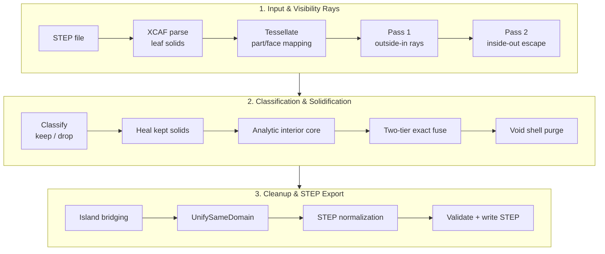
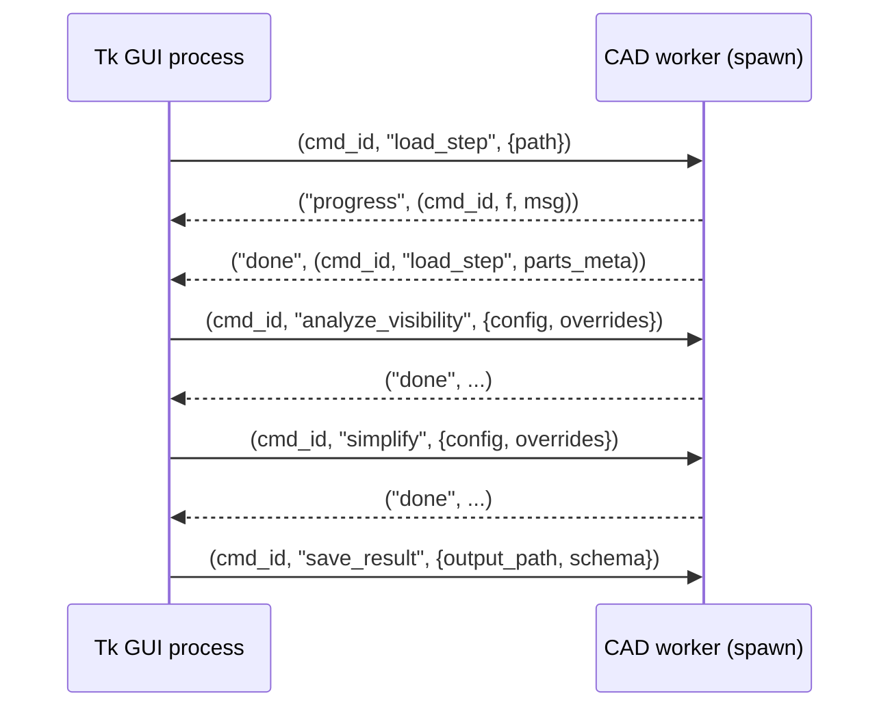

# Theory Behind SIMPLE 3D STEP

> **Language:** **English** | [한국어 (theory_ko.md)](theory_ko.md)

This document expands the **Key Features** section of [README.md](../README.md) into the
mathematical and algorithmic background of the pipeline. Every threshold, weight, and
formula quoted here is the one used by the implementation in `src/simple_3d_step/core/`,
so the text doubles as a map from theory to code.

**Contents**

1. [Problem statement and pipeline](#1-problem-statement-and-pipeline)
2. [STEP assembly parsing (XCAF)](#2-step-assembly-parsing-xcaf)
3. [Two-pass exterior visibility analysis](#3-two-pass-exterior-visibility-analysis)
4. [Exact B-Rep solidification](#4-exact-b-rep-solidification)
5. [Cross-kernel STEP normalization](#5-cross-kernel-step-normalization)
6. [Freeze-free GUI and multi-core architecture](#6-freeze-free-gui-and-multi-core-architecture)
7. [Complexity and parameter guide](#7-complexity-and-parameter-guide)
8. [Assumptions and limitations](#8-assumptions-and-limitations)
9. [References](#9-references)

---

## 1. Problem statement and pipeline

Given an assembly $\Omega=\bigcup_{i=1}^{N}\Omega_i$ of $N$ solids (housings, covers,
rotors, gears, bearings, PCBs, fasteners), the goal is a single closed solid $\Omega^{\ast}$
such that

```math
\partial\Omega^{\ast} \cap \partial\Omega_{\text{ext}} \;\approx\; \partial\Omega_{\text{ext}},
\qquad
\operatorname{interior}(\Omega^{\ast}) \;\supset\; \operatorname{interior}(\Omega),
```

where $\Omega_{\text{ext}}$ is the union of *externally visible* parts and
$\operatorname{interior}$ means the enclosed material volume. In words: **keep every
exterior B-Rep surface exactly as authored, remove hidden internal parts, and fill the
enclosed interior so cross-sections show solid material.**

The implementation is a deterministic sequence of stages:



| Stage | Entry point | Progress band |
| :--- | :--- | :---: |
| Load + hierarchy flattening | `core/step_io.py::load_step_assembly` | – |
| Tessellation | `core/tessellation.py::tessellate_assembly` | 0 – 0.35 |
| Pass 1 ray casting | `core/visibility.py::analyze_visibility` | 0.40 – 0.80 |
| Pass 2 escape check | idem | 0.80 – 0.97 |
| Heal + optional hole plugging | `core/solidifier.py` | 0.06 – 0.12 |
| Interior core | `_build_analytic_interior_core` | 0.20 – 0.32 |
| Boolean fuse | `_batch_fuse_safe` | 0.40 – 0.80 |
| Void purge / bridging / unify | `_remove_closed_void_shells`, `_connect_floating_islands` | 0.82 – 0.91 |
| STEP normalization + validation | `_sanitize_for_step_compat`, `validate_shape` | 0.94 – 1.00 |

Notation used below: $D$ is the assembly bounding-box diagonal, $D_i$ a part diagonal,
$A_i$ a part's B-Rep surface area, $T$ the triangle count, and $\tau$ the minimum visible
ratio (`min_visible_ratio_pct / 100`).

---

## 2. STEP assembly parsing (XCAF)

### 2.1 Label graph and placement composition

A STEP AP214/AP242 assembly is read into an XCAF document. The document is a labelled
graph: product definitions, assemblies, instances (references), and sub-shapes. Each
instance label carries a `TopLoc_Location`, i.e. a rigid transform

```math
T = \begin{bmatrix} R & \mathbf{t} \\ \mathbf{0}^\top & 1 \end{bmatrix},
\qquad R \in SO(3),\; \mathbf{t}\in\mathbb{R}^3 .
```

Walking from a root product $p_0$ through child instances $p_1,\dots,p_k$ composes the
global placement

```math
T_{\text{global}} = T_{p_0}\,T_{p_1}\cdots T_{p_k},
\qquad \mathbf{x}_{\text{world}} = T_{\text{global}}\,\mathbf{x}_{\text{local}} .
```

Reference labels are resolved recursively (`XCAFDoc_ShapeTool.IsReference_s` +
`GetReferredShape_s`), so an identical part instanced many times yields one shape and
$k$ placements. The implementation then extracts **leaf solids and free shells**

```math
\partial\Omega_i = \text{solids}(\text{shape}) \;\cup\; \text{shells}(\text{shape})\setminus \text{solids},
```

and splits multi-body parts into `[Body k]` leaves. This normalization is what makes the
rest of the pipeline shape-agnostic: everything downstream operates on a flat list of
`PartNode`s with globally placed `TopoDS_Shape`s.

### 2.2 Geometric invariants

Per leaf, OpenCASCADE's exact B-Rep integral properties (`BRepGProp`) are evaluated:

- **Volume** by the divergence theorem with $\nabla\cdot\mathbf{x}=3$:

  ```math
  V = \int_{\Omega} dV
    = \frac{1}{3}\int_{\partial\Omega}\mathbf{x}\cdot\mathbf{n}\,dA ,
  ```

  evaluated analytically on the B-Rep faces (planes, cylinders, NURBS, …), not on a mesh.
- **Surface area** $A=\int_{\partial\Omega} dA$.
- **Axis-aligned bounding box** from `Bnd_Box` (tight, per-shape).
- **Face count** by `TopExp_Explorer(..., TopAbs_FACE)`.

These invariants drive classification thresholds, the volume guards on Boolean
operations, and the final validation report, so they must be exact rather than
tessellation-derived.

### 2.3 Units and non-ASCII paths

The reader reports the length unit from `Interface_Static("xstep.cascade.unit")`
(`MM` by default) and passes it to the writer. Because OCCT's file API is not Unicode
aware on all platforms, paths containing non-ASCII characters are copied to a temporary
ASCII directory for the read/write call and the result is moved back
(`_ensure_ascii_read_path` in `core/step_io.py`).

---

## 3. Two-pass exterior visibility analysis

The question "is part $i$ visible from outside?" is answered on a triangle mesh, then
mapped back to B-Rep faces. The mesh exists only for analysis: **no mesh ever reaches the
output**.

### 3.1 Tessellation with exact part/face provenance

`BRepMesh_IncrementalMesh` tessellates each part with a linear deflection derived from the
assembly size and a per-part cap for small parts:

```math
\delta_L = \max\!\left(0.05,\; 0.0025\,D\right),
\qquad
\delta_i = \min\!\left(\delta_L,\; \max\!\left(0.02,\; 0.02\,D_i\right)\right),
\qquad
\alpha = 0.5\ \text{rad}.
```

Because OCCT's Python bindings (OCP) hold the Python GIL during C++ calls while
`BRepMesh_IncrementalMesh(..., theInParallel=True)` distributes all faces inside a single
call across OCCT's native C++ thread pool (`OSD_Parallel`), meshing parts one-by-one would
starve multi-core CPUs on small components. The implementation therefore groups parts into
logarithmic deflection buckets (`mesh_shapes_in_parallel_buckets`),

```math
b_i = \left\lfloor \frac{\ln \delta_i}{\ln 1.5} \right\rfloor,
\qquad
\delta_{\text{bucket}}(b) = \min_{i:\, b_i = b} \delta_i ,
```

wraps each bucket in a `TopoDS_Compound`, and meshes finest buckets first so every face
receives a deflection at least as fine as $\delta_i$ while saturating all C++ threads.
Instance placement transforms (`TopLoc_Location`) are applied per face as a vectorized
$3\times 4$ affine matrix in NumPy (`extract_shape_triangles`).

Triangles are appended in a single global buffer with parallel arrays

```math
\texttt{tri\_part\_id}[t],\quad \texttt{tri\_face\_id}[t],\quad
a_t = \tfrac{1}{2}\left\|(\mathbf{v}_1-\mathbf{v}_0)\times(\mathbf{v}_2-\mathbf{v}_0)\right\|,
\quad
\hat{\mathbf{n}}_t = \frac{(\mathbf{v}_1-\mathbf{v}_0)\times(\mathbf{v}_2-\mathbf{v}_0)}{\left\|\cdot\right\|}.
```

Winding is corrected for `TopAbs_REVERSED` faces so $\hat{\mathbf{n}}_t$ points outward,
and the `trimesh.Trimesh` is built with `process=False` so triangle indices are **not**
merged or reordered. That invariant is what lets a triangle hit be traced back to an
exact `TopAbs_FACE` of an exact `PartNode` — the bridge between the approximate
visibility decision and the exact B-Rep output. The cached `TessellatedAssembly` is also
reused during solidification (`build_subset_trimesh`) so the kept parts are never
re-tessellated from scratch.

### 3.2 Fibonacci sphere viewpoints

View directions are a Fibonacci (golden-angle) spiral on $S^2$. For $i=0,\dots,n-1$ and
$u_i=(i+\tfrac{1}{2})/n$:

```math
z_i = 1-2u_i,\qquad
\theta_i = \pi\left(1+\sqrt{5}\right)u_i,\qquad
\mathbf{v}_i = \left(\sqrt{1-z_i^2}\cos\theta_i,\ \sqrt{1-z_i^2}\sin\theta_i,\ z_i\right).
```

Uniformity in $z$ gives equal-area cells ($4\pi/n$ each) and the golden-angle increment
keeps consecutive samples far apart, so a modest $n$ covers the sphere without the poles
of a latitude/longitude grid. Presets: **Fast 26**, **Standard 64**, **Fine 162**.

### 3.3 Pass 1 — outside-in orthographic ray grids

For view $i$ the camera looks along $\mathbf{d}_i=-\mathbf{v}_i$ from

```math
\mathbf{o}_i = \mathbf{c} + R\,\mathbf{v}_i,\qquad
R = 0.525\,D,\qquad
\mathbf{c}=\tfrac{1}{2}(\mathbf{b}_{\min}+\mathbf{b}_{\max}).
```

A square grid of $m\times m$ samples spans $[-R,R]^2$ in the view plane, step
$s=2R/(m-1)$, restricted to the inscribed disk

```math
u_j^2+v_j^2 \le 1.04\,R^2
```

(about 21 % of corner rays are wasted otherwise). Each view is offset by a golden-ratio
sub-pixel jitter

```math
j_x^{(i)} = \left(\left\{\varphi\,i\right\}-\tfrac{1}{2}\right)s,\qquad
j_y^{(i)} = \left(\left\{\varphi^{-2}i\right\}-\tfrac{1}{2}\right)s,\qquad
\varphi=\frac{1+\sqrt{5}}{2},
```

which turns the per-view sampling lattices into a low-discrepancy union and prevents
systematic aliasing of thin ribs, fins, and bolt heads.

Each ray is intersected with the BVH (`trimesh` ray intersector backed by Intel Embree)
using **first hit only** (`intersects_first`):

```math
h_t \in \{0,1\},\qquad
H_i = \sum_{t\in \text{part } i} h_t .
```

Because `embreex` releases the Python GIL (`nogil`) during `EmbreeScene.run()` while
running a single-threaded C++ loop per call, the BVH is committed once on the main thread
and views are dispatched concurrently across a `ThreadPoolExecutor` (capped at $\le 12$
threads per worker, where shared-BVH memory bandwidth saturates). Each completed view's
hit indices are accumulated on the main thread via `np.bincount`, yielding bit-for-bit
identical counts to single-threaded execution.

### 3.4 From hits to exposed area (Cauchy integral geometry)

A hit count is not an area: one ray can hit a huge triangle or a tiny one. The estimator
uses Cauchy's surface-area formula. For a body with surface area $A$ and a random
orientation, the **mean projected area** over the viewing hemisphere is

```math
\overline{A_{\parallel}} = \frac{A}{4}.
```

Over $n_v$ views with ray footprint $s^2$, the sampled projected area per view is
$H_i s^2 / n_v$, hence

```math
\widehat{A}_{\text{vis},i} = \frac{4\,H_i\,s^2}{n_v}.
```

The code takes the conservative minimum of this Cauchy estimate and the raw area of the
triangles that were hit,

```math
\widetilde{A}_i = \min\!\left(\sum_{t:\ h_t>0} a_t,\ \ \widehat{A}_{\text{vis},i}\right),
\qquad
\rho_i = \min\!\left(1,\ \frac{\widetilde{A}_i}{A_i}\right).
```

**Why the minimum?** Summing $a_t$ over hit triangles over-counts grazing triangles: a
single ray can mark an entire 50 mm² face as exposed. The Cauchy term converts hit counts
into an area estimate independently of triangle size, but assumes an isotropic
orientation distribution, which is only approximate for strongly non-convex bodies.
Taking the minimum keeps the estimate conservative — a part is only declared exposed if
both estimators agree that meaningful area is visible.

### 3.5 Pass 2 — inside-out hemisphere escape check

Parts with small $\rho_i$ are ambiguous: a hidden internal part and a small but real
external part (a bolt, a connector, a boss) both return few first hits. The second pass
tests the opposite direction: shoot rays **outward from the part's own surface** and check
whether any escape to infinity.

Borderline set:

```math
B=\left\{\,i \;:\; \rho_i < \tau_2 \,\right\},
\qquad
\tau_2 = \max\!\left(2.5\,\tau,\ 0.025\right).
```

For each $i\in B$, $n_s=\min(48,\max(12,T_i))$ triangles are drawn **area-proportionally**,
$P(t)=a_t/A_i$, and $K=32$ hemisphere directions are generated with $z_j=(j+\tfrac{1}{2})/K$
(uniform in $z$ and $\theta$ ⇒ uniform area measure on the hemisphere), rotated into each
triangle's local frame $(\mathbf{u},\mathbf{w},\hat{\mathbf{n}})$:

```math
\mathbf{r}_j = h_{x,j}\,\mathbf{u} + h_{y,j}\,\mathbf{w} + h_{z,j}\,\hat{\mathbf{n}},
\qquad
\mathbf{o}_j = \mathbf{c}_t + \epsilon\,\hat{\mathbf{n}},
\qquad
\epsilon=\max\!\left(2\times10^{-4}D,\ 0.01\right).
```

The escape ratio is the fraction of rays that hit nothing:

```math
e_i = \frac{1}{n_s K}\sum_{s=1}^{n_s}\sum_{j=1}^{K}
\mathbf{1}\!\left[\text{ray }(s,j)\text{ escapes}\right].
```

Random surface samples are drawn sequentially on the main thread (`default_rng(42)`) before
dispatching the `intersects_any` batches to the same `ThreadPoolExecutor`, preserving
exact RNG determinism across any thread count.

### 3.6 Classification rule

The visibility score merges both passes:

```math
v_i = \max\!\left(\rho_i,\ e_i\right),
\qquad
\text{status}(i)=
\begin{cases}
\text{External (keep)} & v_i \ge \tau \ \text{and}\ V_i \ge V_{\min},\\[2pt]
\text{Internal (drop)} & \text{otherwise}.
\end{cases}
```

- $\tau$ = `min_visible_ratio_pct / 100` (default $0.005$ = 0.5 %).
- $V_{\min}$ (`min_part_volume_mm3`) is an optional volume floor, disabled by default.
- A user override $u_i$ (Keep/Drop toggled in the parts table) always wins:
  classification updates `auto_status` but never touches `keep` when `user_overridden`
  is set.

The final B-Rep list is therefore

```math
\text{kept} = \{\,i : \text{status}(i)=\text{External} \text{ or } u_i=\text{Keep}\,\}.
```

B-Rep faces of a kept part that were hit (or escaped in Pass 2) are recorded as
`part_visible_faces`; they are the audit trail for "the exterior we promised to preserve".

---

## 4. Exact B-Rep solidification

The solidifier never modifies a kept exterior face and never applies a cut to an exterior
solid. It only (a) builds new **strictly interior** analytic material and (b) applies
**unions** under volume guards.

### 4.1 Healing

Each kept shape is checked with `BRepCheck_Analyzer(..., parallel=True)` (C++ parallel
validation via `make_brep_check_analyzer`); invalid shapes go through `ShapeFix_Shape`.
Free shells are promoted to solids with `BRepBuilderAPI_MakeSolid` + `ShapeFix_Solid`. A
part that cannot be healed is excluded from the fuse and reported.

### 4.2 Optional small-hole plugging (off by default)

With `remove_small_holes`, cylindrical faces are classified as concave bores. Let
$\mathbf{x}$ be a surface point, $\mathbf{n}$ its outward normal, $\mathbf{a}$ the cylinder
axis and $\mathbf{x}_a$ the closest point on the axis. The face is an internal hole when

```math
\frac{\mathbf{x}_a-\mathbf{x}}{\left\|\mathbf{x}_a-\mathbf{x}\right\|}\cdot\mathbf{n} > 0,
```

i.e. the outward normal points *toward* the axis (the material is outside the bore). If the
radius is $r\le d_{\max}/2$, the bore is removed with `BRepAlgoAPI_Defeaturing` (plus
`ShapeUpgrade_RemoveInternalWires` with minimum enclosed area $\pi r^2\cdot1.1$), guarded by

```math
V' \ge 0.98\,V,
```

and limited to solids with $\le 250$ faces and $\le 16$ hole faces for robustness. The
feature is off by default because it deliberately changes exterior geometry.

### 4.3 Analytic interior core

This is the only step that "adds material". It works on a padded voxel grid and converts
its result into **analytic** primitives (cylinders, planar prisms), never into voxel
facets.

**Grid.** With longest extent $L_{\max}=D$ and resolution $R$ (`core_grid_resolution`,
default 120, clamped to $[64,180]$):

```math
h = \frac{L_{\max}}{R},\qquad
\text{pad}=\left\lceil g/h \right\rceil + 3,\qquad
\text{dims} = \left\lceil \mathbf{e}/h \right\rceil + 2\,\text{pad} + 1,
```

where $g$ = `core_bridge_gap_mm`.

**Occupancy.** The kept-part triangle mesh is extracted directly from the cached
`TessellatedAssembly` (`build_subset_trimesh`, falling back to parallel bucketed meshing if
called standalone). After pre-warming the Embree BVH and trimesh face caches on the main
thread, three axis-aligned Embree sweeps (rays along X, Y, Z, split into tiles of 4,096
rays and run across a `ThreadPoolExecutor`) mark every voxel that contains a surface
intersection (`multiple_hits=True`):

```math
O[i,j,k] = \mathbf{1}\!\left[\text{some ray hit voxel }(i,j,k)\right].
```

**Sealed interior.** Air is $\neg O$; the outside component is the connected component
containing the padded corner voxel. Then

```math
\text{inside}_0 = \left\{\,x \in \neg O \;:\; \text{label}(x)\neq \text{label}(\mathbf{0})\,\right\}.
```

Only regions *not reachable from outside* count as enclosed cavity. An open through-hole
or a slot therefore lets air connect to the border and is **not** filled — this is why the
exterior is preserved even with open windows and bores.

**Gap bridging (morphological closing).** Neighboring parts are often separated by
running clearances (rotor/cover gaps, bearing fits) of a few tenths of a millimetre. With
$r_c = g/h$:

```math
D_O=\operatorname{EDT}(\neg O),\quad
O_r = \left\{D_O \le r_c\right\},\quad
\text{filled} = \left\{\,x \in \neg O_r : \text{label}(x)\neq \text{label}(\mathbf{0})\,\right\},
```

```math
E = \left\{\,x : \operatorname{EDT}(\text{filled})(x) > r_c\,\right\}\ \cup\ O,
\qquad
\text{inside} = \left\{\,x \in \neg E : \text{label}(x)\neq \text{label}(\mathbf{0})\,\right\}.
```

Dilation followed by erosion closes gaps up to roughly $2r_c$ in voxel units while
preserving the outer boundary. The closing is only applied when $r_c \ge 0.75$ voxels
(≈0.75 grid pitches); below that the raw sealed interior $\text{inside}_0$ is used unchanged, so
a tiny bridge-gap setting can never distort the cavity. The result is a sealed *envelope*
whose enclosed air is the cavity volume between parts.

**Strict inward safety inset.** With $D_E=\operatorname{EDT}(E)$ in millimetres:

```math
C_{\text{safe}} = \left\{\,x \in \text{inside} \;:\; D_E(x) \ge \max\!\left(\texttt{core\_inset\_mm},\ 1.6\,h\right)\right\}.
```

The inset is what guarantees that no core voxel can touch an exterior wall, a cooling fin
valley, or a recessed pocket: by construction every kept voxel is at least `inset` away
from any envelope boundary.

**26-direction sky-visibility carving.** Voxels that are inside the envelope but were
*not* strictly sealed in the raw occupancy grid are suspicious: they may sit in an open
external recess that only the bridged envelope closed. Each such voxel casts the 26
lattice directions (6 face + 12 edge + 8 corner normals)

```math
\mathcal{D}_{26} = \left\{\frac{(d_x,d_y,d_z)}{\left\|(d_x,d_y,d_z)\right\|} \;:\; d_{x,y,z}\in\{-1,0,1\},\ (d_x,d_y,d_z)\neq\mathbf{0}\right\}.
```

The sky-visibility fraction is

```math
\varsigma(x)=\frac{1}{26}\sum_{\mathbf{d}\in\mathcal{D}_{26}}
\mathbf{1}\!\left[\text{ray } (x,\mathbf{d}) \text{ escapes}\right],
\qquad
x \text{ is carved if } \varsigma(x)\ge 0.15 .
```

Carved voxels are dilated by one voxel as a safety margin. Candidate voxels are evaluated
in 4,000-voxel chunks across the same `ThreadPoolExecutor` (`intersects_any`). The 15 %
threshold tolerates narrow slits and draft angles while still catching anything with a
wide-open line of sight to the outside (heatsink fin gaps, counterbores, cable channels).

**Slicing axis.** For each axis, up to 12 cross-sections $C$ are scored by circularity

```math
\kappa(C)=\frac{\pi\,r_{\max}^2}{|C|},
\qquad r_{\max}=\max\operatorname{EDT}(C),
```

and the axis with the largest mean $\kappa$ is used as the extrusion direction. Choosing
the axis that produces the roundest cross-sections maximizes the number of analytic
cylinders (cheap, smooth) and minimizes polygon approximation error.

**Analytic primitive extraction.** Starting from a base slab thickness of
$w=\max(2,\operatorname{round}(3/h))$ voxels (≈3 mm), each slab is **greedily extended**
along the slice axis while the cumulative cross-section remains constant:

```math
\frac{\left|\,\bigcap_{j=w_0}^{w_{\text{end}}+1} C_{\text{safe}}[:,:,j]\,\right|}
     {\left|\,\bigcup_{j=w_0}^{w_{\text{end}}+1} C_{\text{safe}}[:,:,j]\,\right|}
\;\ge\; 0.94 ,
```

with an overlap $\max(0.25,0.45h)$ between consecutive slabs to avoid seams. Within slab
$k$ the cross-section is always the **intersection** of all voxel slices in the slab,

```math
C_k = \bigcap_{j\in\text{slab}} C_{\text{safe}}[:,:,j],
```

so strict containment inside $C_{\text{safe}}$ is guaranteed even where the cavity tapers,
while long uniform bores and rectangular housings collapse into single tall primitives
rather than dozens of 3 mm slices. Holes are filled, connected components smaller than
20 mm² are dropped, and each component becomes either

- a **cylinder** if its inscribed radius $r^{\ast}=h\max\operatorname{EDT}$ satisfies
  $r^{\ast}\ge 2.5$ mm and $\pi r^{\ast 2}/|C_k|\ge 0.84$, with radius $\max(r^{\ast}-0.1,0.5)$ mm;
  adjacent coaxial cylinders (center shift $\Delta c \le 0.25$ mm, $|\Delta r| \le 0.35$
  mm) are further coalesced into one cylinder with conservative radius
  $r_{\text{merged}} = \min(r_1, r_2) - \tfrac{1}{2}\Delta c$ so the merged body stays
  strictly contained inside both original cylinders; or
- a **polygonal prism** built from the largest contour, simplified with
  `approximate_polygon` at tolerance $\max(0.75, 0.55/h)$ **contour pixels**, extruded
  along the slice axis.

Both are exact analytic B-Rep primitives (`BRepPrimAPI_MakeCylinder`,
`BRepBuilderAPI_MakeFace` + `BRepPrimAPI_MakePrism`), so the exported STEP contains only
planes and cylinders in the filled region — no triangulated “voxel look”.

### 4.4 Precision-first Boolean fuse

Fusing exact B-Rep operands is numerically delicate when faces are tangent or nearly
coincident (mating flanges, bearing seats, gear teeth). The implementation never starts
with a loose tolerance:

```math
\text{fuzzy schedule} = \left(0,\ 10^{-5},\ 10^{-4},\ 10^{-3},\ 5\times10^{-3}\right)
\ \text{mm}.
```

For a pair with volumes $v_1,v_2$ the result is accepted only if

```math
V_{\min} = \max(v_1,v_2)-\max\!\left(0.5,\ 0.01\min(v_1,v_2)\right)
\;\le\; V_{\text{fused}} \;\le\;
1.01\,(v_1+v_2)+1 .
```

This guard rejects the classic silent failure mode in which a Boolean returns a valid-looking
shape that has lost one operand (tangent-face collapse, disjoint tools, tolerance
swallowing). Only if exact fusion fails or fails the guard is the tolerance raised, one
step at a time.

The batch path is stricter: a single multi-tool `BRepAlgoAPI_Fuse` (`SetRunParallel(True)`
with global `BOPAlgo_Options.SetParallelMode_s(True)`) is attempted **only** at $\text{fuzzy}=0$,
accepted if

```math
V_{\text{fused}} \ge 0.99\max_i v_i
\quad\text{and}\quad
V_{\text{fused}} \le 1.01\sum_i v_i + 1,
```

otherwise the code falls back to a **spatial-proximity balanced binary-tree fuse**: at each
tree level, operands are greedily paired by nearest bounding-box center so touching bodies
merge into balanced sub-assemblies ($O(N\log N)$ face-intersection growth rather than an
$O(N^2)$ linear accumulator chain), restarting each pair's fuzzy schedule at $0$ (with a
sequential rescue pass only if an entire round yields zero merges). A globally loosened
batch tolerance would corrupt *all* tangent contacts at once; per-pair escalation localizes
the damage.

**Two tiers.** Parts with $v_i \ge 0.015\sum_j v_j$ (housings, covers, rotors — at least
1.5 % of kept volume) plus the analytic core are fused first, and closed void shells are
purged **immediately**; the remaining small parts (connectors, screws, brackets) are fused
afterwards. Removing hidden voids early prevents internal gear teeth and pockets from
participating in later intersections, which reduces sliver creation and failure rates.

### 4.5 Closed void-shell purge

A "solid" may enclose an empty cavity:

```math
V(\Omega) = V_{\text{outer}} - \sum_{j} V_{\text{void},j}.
```

After solidification we require $\sum_j V_{\text{void},j}=0$ so that clipping planes show
material everywhere inside the outer skin.

**Multi-shell case.** If the solid has more than one `TopoDS_Shell`, the outer shell is
identified by `BRepClass3d.OuterShell_s`; if that fails, every shell is promoted to a
candidate solid and the one enclosing the largest volume is chosen. Rebuilding the solid
from the outer shell only gives $V' = V_{\text{outer}}$, and the change is accepted when

```math
V' \ge 0.999\,V .
```

**Hidden single-shell case.** Healing and Boolean operations can place a closed cavity
*inside the same* `TopoDS_Shell` as the outer boundary, so the shell count stays 1 while
the part is still hollow. This is detected with the face-adjacency graph of the B-Rep:

```math
G_F=(V_F,E_F),\qquad
V_F=\{\text{faces}\},\qquad
(u,v)\in E_F \iff u \text{ and } v \text{ share a B-Rep edge}.
```

Connected components of $G_F$ are computed by BFS. In OCP 8.x, iterating
`MapShapesAndAncestors` shape lists in Python incurs heavy per-edge binding overhead, so
$G_F$ is built in reverse via `TopExp.MapShapes_s` on faces and edges plus a per-face
`TopExp_Explorer(..., TopAbs_EDGE)` lookup (an order-of-magnitude faster while yielding the
exact same adjacency graph). The outermost component (largest bounding-box diagonal, ties
broken by face count) is rebuilt into a shell (`BRep_Builder`), converted to a solid,
healed with `ShapeFix_Solid`, oriented outward with `BRepLib.OrientClosedSolid`, and
accepted if

```math
V' \ge 0.95\,V .
```

The 5 % relaxation accounts for the fact that component volume is only a proxy for shell
nesting; a physically impossible loss of material is still rejected.

### 4.6 Bridging clearance-separated exterior islands

If the fuse leaves more than one solid, nearby islands are connected with **hidden internal
pins** rather than deleted. With the main body $M$ (largest volume) and island $I$:

1. Skip if $I$ lies strictly inside $M$: bounding boxes nested **and**
   `BRepClass3d_SolidClassifier(M, centroid(I)) == TopAbs_IN`.
2. Compute the closest vertex pair between tessellated surfaces (main body and islands
   batch-meshed together at 0.25 mm via `mesh_shapes_in_parallel_buckets`, queried in
   parallel via `cKDTree.query(..., workers=-1)`):

   ```math
   d_{\min}=\min_{a\in I,\; b\in M}\left\|a-b\right\|,\qquad
   (a^{\ast},b^{\ast})=\arg\min .
   ```

3. If $d_{\min} > g_{\max}$ (`max_island_gap_mm`, default 3 mm), leave the island
   untouched (it will be excluded by `keep_largest_only` or remain a separate body if that
   option is disabled).
4. Otherwise build a pin along
   $\hat{\mathbf{u}}=(b^{\ast}-a^{\ast})/d_{\min}$ starting at $a^{\ast}-\hat{\mathbf{u}}p$ with

   ```math
   r = \operatorname{clamp}\!\left(0.28\min\!\left(\dim(I)\right),\;0.3,\;1.5\right),
   \qquad
   p = \operatorname{clamp}\!\left(0.35\min\!\left(\dim(I)\right),\;0.5,\;1.5\right),
   ```

   length $d_{\min}+2p$ so it penetrates both bodies.
5. Fuse `main + pin` and then `+ island`, each under the pair guard, and require a single
   resulting solid; purge voids afterwards.

Pins are short, thin, and lie in the internal clearance between near-touching parts, so
they are invisible in exterior views and on section cuts outside the joint region.

### 4.7 Face unification

`ShapeUpgrade_UnifySameDomain(shape, unifyEdges=True, unifyFaces=True,
concatBSplines=False)` merges coplanar/co-cylindrical faces and their shared edges
(typically collapsing Boolean fragmentation into the original modelling faces). Because
unification can, in pathological cases, re-open seams, the result is accepted only if

```math
\text{solids}'=\text{solids},\qquad
\text{shells}'\le\text{shells},\qquad
\text{watertight}'=\text{true},\qquad
\frac{|V'-V|}{V}<0.01 .
```

Otherwise the pre-unification shape is kept.

---

## 5. Cross-kernel STEP normalization

The final shape must survive a round trip through other kernels, not just OCCT 8.x. Most
"solid becomes surface" complaints from OCCT 7.x viewers (e.g. CAD Assistant) come from
three defects: periodic seam pcurves, loose `UNCERTAINTY`, and faces that BRepMesh cannot
triangulate. Each is treated explicitly.

### 5.1 Periodic surface splitting and wire healing

A full-revolution cylinder/cone/torus has a periodic parameter $u\in[0,2\pi]$ whose seam
is represented by a degenerate pcurve. When a reader rebuilds pcurves from 3D curves, the
seam wire may appear *lacking* and the face is treated as open. `ShapeUpgrade_ShapeDivideClosed`
with one split point turns every periodic face into two 180° non-periodic faces, so the
seam becomes real boundary edges. `ShapeFix_Shape` then repairs wires and tolerances with

```math
\text{precision}=10^{-4},\qquad \text{max tolerance}=10^{-3}.
```

The transformation is accepted only if it preserves solids, does not increase shells,
stays watertight, keeps volume within 1 %, and does not increase the count of
`CheckLacking` wire defects.

### 5.2 pcurve-free round trip and precision clamping

The writer configures OCCT to export **3D curves only**:

```
write.surfacecurve.mode = 0     # no pcurves; readers recompute them from 3D geometry
write.precision.mode    = 2     # user-defined uncertainty
write.precision.val     = clamp(avg_tolerance, 1e-5, 1e-3)
```

where `avg_tolerance` comes from `ShapeAnalysis_ShapeTolerance`. The clamp matters: a
derived value of $10^{-2}$ mm lets readers collapse fine edges and coarse-facet the model,
while a forced $10^{-5}$ mm can exceed the geometric validity of Boolean output. The shape
is then re-imported from that temporary STEP (`_normalize_via_step_3d_curves`) so the
in-memory shape has **exactly the pcurves and tolerances an external viewer will see** —
stale in-memory pcurves cannot mask portability problems.

### 5.3 Mesh-blocking slivers and clipping capping

OCCT's shaded-solid exploration classifies a solid as *Opened* if even one face yields a
NULL triangulation at the viewer's deflection. The audit reproduces CAD Assistant's
profiles:

```math
(\text{relative},\ \text{angular}) \in \{(0.001,0.50),\ (0.001,0.35)\},
\qquad
(\text{absolute},\ \text{angular}) \in \{(0.001,\ldots,0.004)\,L_{\max},\ 0.35\}.
```

If any face fails, two repairs are attempted, each guarded by the same validity/volume
checks:

1. `ShapeFix_FixSmallFace` with precision 0.015 mm collapses razor-thin tangent slivers
   (from Boolean intersections) that cannot be triangulated.
2. Exact midpoint splitting of long curved edges **only on failing faces**
   (`_split_edge_exact_subedges`): the sub-edges lie on the same 3D curve, so geometric
   error is exactly zero, while the maximum chord sagitta of the viewer's tessellation
   drops. For a circular arc of radius $R$ and angle $\theta$, chord deviation is

   ```math
   \delta \approx R\left(1-\cos\frac{\theta}{2}\right) \approx \frac{R\,\theta^2}{8},
   ```

   so halving $\theta$ quarters the deviation without adding faces.

### 5.4 Final validation

`validate_shape` reports exact B-Rep metrics:

- `BRepCheck_Analyzer(..., parallel=True)` multi-threaded topological/geometric validity,
- solid/shell counts (`TopExp_Explorer`),
- free edges via `ShapeAnalysis_FreeBounds` (closed wires + open wires),
- volume/surface area (`BRepGProp`), bounding box, and analytic surface-type histogram.

A result is a **valid single solid** if and only if

```math
\text{valid}_{\text{BRep}} \ \wedge\ N_{\text{solid}}=1 \ \wedge\ N_{\text{shell}}=1
\ \wedge\ N_{\text{free edges}}=0 \ \wedge\ V>0 .
```

$N_{\text{shell}} = 1$ is the operational definition of "no remaining internal void shells", and
$N_{\text{free edges}}=0$ is watertightness.

---

## 6. Freeze-free GUI and multi-core architecture

OCCT C++ calls (STEP read/write, Booleans, `UnifySameDomain`) hold the Python GIL for
seconds. Running them in the Tk event thread produces `Not Responding` windows. The GUI is
therefore split into a **Tk front end** and one or more **persistent CAD worker processes**.

### 6.1 Process and message model

Only serializable *metadata* crosses the process boundary; `TopoDS_Shape` objects stay in
the worker's memory:



- **Liveness.** The GUI polls all active worker event queues every 40 ms (`after(40, ...)`)
  and never blocks, so worst-case UI latency is one poll interval regardless of C++ duration.
- **Cancellation.** A shared cancel event is checked at coarse checkpoints (per part, per
  view, per slab, per fuse pair). A C++ kernel call itself is not interruptible; the
  *Force Stop* action terminates the active worker process(es) and respawns clean
  replacements (`spawn` context), at the cost of losing the in-memory assembly (Single Mode
  reloads on demand).
- **Crash containment.** Worker death is detected during polling and reported as a crash;
  the worker restarts automatically.
- **Mode isolation.** Single Mode owns one dedicated worker and Batch Mode owns a lazily
  started worker pool (first slot created on tab activation; additional slots spawned up to
  `batch_workers` when RUN starts), so a long batch never blocks interactive inspection and
  each mode's in-memory assembly stays valid.

### 6.2 Batch-mode parallel state machine

A batch item moves through `Pending → Running → Done | Failed | Cancelled | Skipped`.
Up to $W$ files execute concurrently in separate persistent CAD worker slots (`_WorkerSlot`),
each advancing its assigned file through the same four stages. Overall progress aggregates
finished files and all in-flight slots:

```math
p=\frac{n_{\text{done}}+\sum_{s\in\text{active}}\ell_s}{n_{\text{total}}},
\qquad 0 \le \ell_s < 1 ,
```

where $n_{\text{done}}$ is the number of finished files and $\ell_s$ is the fraction of slot $s$
completed inside its current stage's band:

| Stage | Command | Band |
| :--- | :--- | :---: |
| Load | `load_step` | 0.00 – 0.12 |
| Visibility | `analyze_visibility` | 0.12 – 0.42 |
| Solidify | `simplify` | 0.42 – 0.90 |
| Save | `save_result` | 0.90 – 1.00 |

Outputs are written next to each source as `<stem>_simplified.step`; the destination is
computed per file, so a heterogeneous queue (different folders) writes each result in its
own directory.

Double-clicking a queue row whose output already exists launches the configured external
STEP viewer (`viewer_executable` / `viewer_args` in `config.json`, with the Windows default
association as fallback) — the same viewer integration used by Single Mode, so both modes
review results with identical settings.

### 6.3 Multi-core execution and thread budgeting

The pipeline combines **intra-process native/nogil parallelism** (accelerating a single
STEP file) with **inter-process file-level parallelism** (accelerating GUI Batch Mode and
CLI `--cli ... -j` runs, including OCCT stages that are inherently single-threaded such as
`STEPCAFControl_Reader`, `ShapeUpgrade_UnifySameDomain`, `ShapeFix_*`, and `STEPControl_Writer`):

| Parallelism layer | Mechanism | Stages accelerated |
| :--- | :--- | :--- |
| OCCT C++ pool (`OSD_Parallel`) | `BRepMesh_IncrementalMesh(..., True)`, `BOPAlgo_Options.SetParallelMode_s(True)`, `BRepCheck_Analyzer(..., True)` | Bucketed tessellation, Boolean Fuse, Defeaturing, B-Rep validation |
| Python `ThreadPoolExecutor` (`nogil`) | Concurrent `embreex` queries on pre-committed BVH; `cKDTree(workers=-1)` | Visibility Pass 1 & Pass 2, core 3-axis sweep & 26-dir sky carving, island distance search |
| Multi-process worker pool (`spawn`) | $W$ persistent `CadWorkerClient` slots (GUI Batch) or `ProcessPoolExecutor` (CLI `-j`) | Full end-to-end pipeline across multiple STEP files |

To prevent nested-parallelism thread oversubscription ($W \times C$ threads thrashing CPU
caches) and keep per-worker RAM bounded (~0.5–2 GB per large assembly), worker count $W$
and per-worker thread budget $T_{\text{worker}}$ are computed on a machine with $C$ logical
cores as (`config.py::resolve_batch_workers`, `threads_per_batch_worker`):

```math
W = \min\!\left(n_{\text{files}},\;
\begin{cases}
\min(w_{\text{cfg}},\ C) & w_{\text{cfg}} > 0,\\[2pt]
\min\!\left(6,\ \max\!\left(1,\ \lfloor C/4 \rfloor\right)\right) & w_{\text{cfg}} = 0\ (\text{Auto}),
\end{cases}\right)
\qquad
T_{\text{worker}} = \max\!\left(1,\ \lfloor C / W \rfloor\right).
```

Each worker configures OCCT's `OSD_ThreadPool.DefaultPool_s().Init(T_worker)` (via
`configure_occt_parallelism`) and caps its Embree `ThreadPoolExecutor` at
$\min(T_{\text{worker}}, 12)$ threads. Existing idle workers update their thread budget
dynamically via the `"configure_threads"` IPC command before each batch run.

---

## 7. Complexity and parameter guide

Let $P$ = parts, $F$ = total faces, $T$ = total triangles, $n_v$ = views,
$m$ = grid resolution, $B\le P$ = borderline parts, $n_s$ = samples/part,
$K$ = rays/sample, and $R_{\text{grid}}$ = core grid resolution.

| Stage | Cost |
| :--- | :--- |
| XCAF parse + hierarchy | $O(P\,F)$ |
| Tessellation | $O(T)$ |
| Pass 1 rays | $O\!\left(n_v\,m^2\left(\log T + k\right)\right)$ |
| Pass 2 rays | $O\!\left(B\,n_s\,K\log T\right)$ |
| Core grid + EDT | $O\!\left(R_{\text{grid}}^3\right)$ (≈1.7 M voxels at 120) |
| Core sky carving | $O\!\left(26\,N_{\text{uncertain}}\log T\right)$ |
| Booleans | super-linear in face count; the dominant cost for large housings |

**Choosing visibility parameters.** For $n_v$ evenly spread views and an $m\times m$
disk grid, the sampled solid angle per view is $\approx 4\pi/n_v$ and each view samples
$\approx \tfrac{\pi}{4}m^2$ rays. Typical settings:

| Preset | Views | Grid | Use case |
| :--- | :---: | :---: | :--- |
| Fast | 26 | 112 | rapid iteration, obvious geometry |
| Standard | 64 | 160 | default |
| Fine | 162 | 200 | thin ribs, small bolts, ambiguous parts |

Halving the grid step $s$ quadruples rays but also quarters the footprint area used in the
Cauchy estimate; both estimators converge, so the *ratio* is stable while the noise floor
drops.

**Choosing solidification parameters.**

| Parameter | Default | Effect |
| :--- | :---: | :--- |
| `core_bridge_gap_mm` | 3.5 | closes inter-part clearances up to ≈ $2g$ |
| `core_inset_mm` | 2.0 | minimum distance from any exterior surface |
| `core_grid_resolution` | 120 | voxel resolution; accuracy vs. memory |
| `max_island_gap_mm` | 3.0 | longest pin that may be added |
| `remove_small_holes` / `max_hole_diameter` | off / 10 mm | optional exterior defeaturing |
| `unify_same_domain` | on | face compaction, guarded |
| `keep_largest_only` | on | discards unbridgeable islands instead of exporting a compound |
| `step_schema` | AP214 | AP214 / AP242 / AP203 |
| `batch_workers` / CLI `-j` | 0 (Auto) | concurrent CAD worker processes in Batch Mode / multi-file CLI (`0` = auto up to 6 with per-worker thread budgeting) |

The inset and the grid pitch are coupled: the code enforces
$\text{inset} \ge 1.6h$, so a coarser grid automatically widens the protected shell. If a
wall is thinner than the inset, that wall's interior simply produces no core — by design,
since filling it would risk crossing the exterior surface.

---

## 8. Assumptions and limitations

- **Watertight B-Rep input.** Input solids are expected to be closed/manifold. Open
  shells can be promoted to solids, but their enclosed volume is undefined; results are
  reported with warnings rather than silently accepted.
- **Exterior means "visible from at least one direction".** The classification is a
  visibility test on a finite view set. A part seen only through a very narrow slit may be
  under-sampled; increase views/grid or mark it Keep manually.
- **The Cauchy estimator assumes orientational isotropy.** For strongly non-convex parts
  it is only an estimate; that is exactly why the conservative `min()` and Pass 2 exist.
- **Only *enclosed* cavities are filled.** An open bore, slot, or window keeps its air: the
  flood-fill from the grid border reaches it. Plugging such openings is a separate,
  opt-in defeaturing step (`remove_small_holes`).
- **Openings narrower than the voxel pitch may leak or seal unpredictably.** The 26-ray
  sky check plus the 1-voxel carve dilation are the safety margins.
- **Tangent and near-coincident faces are the hard case for B-Rep Booleans.** Volume
  guards detect losses but cannot repair arbitrary tolerance pathologies; parts that fail
  are skipped and reported.
- **Units and scale.** Volumes are treated as mm³ and distances as mm; the STEP unit is
  preserved on export. A model authored in metres will still run, but mm-scaled defaults
  (inset, bridge gap, hole diameters) then behave differently.
- **STEP portability is empirical.** The normalization targets OCCT 7.x/8.x, SolidWorks,
  eDrawings, FreeCAD and CAD Assistant; exotic surface types or proprietary extensions may
  still require vendor-specific healing.

---

## 9. References

1. OpenCASCADE Technology — *Modeling Algorithms*, *Data Exchange*, `BRepGProp`,
   `BRepAlgoAPI`, `ShapeFix`, `ShapeUpgrade` documentation.
2. Intel Embree — high-performance ray tracing kernels; `trimesh` ray intersector.
3. Cauchy's surface area formula — mean projected area of a convex body equals one quarter
   of its surface area (integral geometry).
4. M. Marques, C. Bouville, *Spherical Fibonacci point sets for illumination integrals*
   (low-discrepancy sphere sampling).
5. R. Saff, A. Kuijlaars, *Distributing many points on a sphere* (golden-angle spirals).
6. P. Felzenszwalb, D. Huttenlocher, *Distance transforms of sampled functions* (exact EDT
   on grids).
7. scikit-image — `find_contours` (marching squares) and `approximate_polygon`
   (Douglas–Peucker).
8. ISO 10303-21 / AP214 / AP242 — STEP file structure and application protocols.
