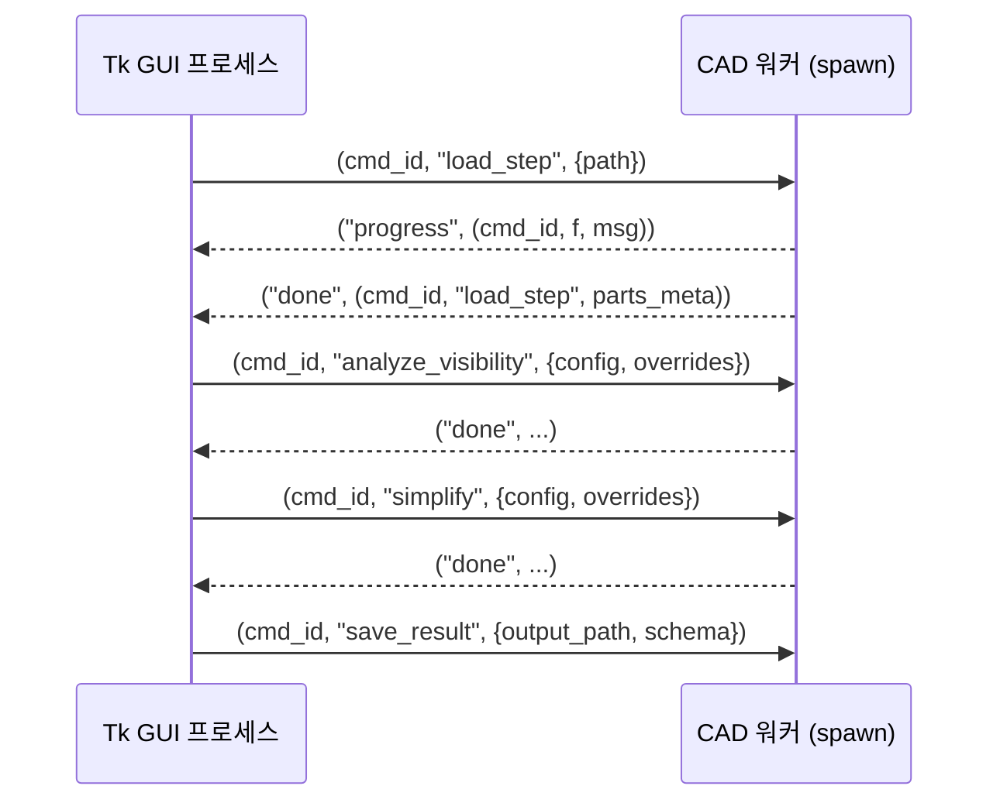

# SIMPLE 3D STEP 이론 문서

> **Language:** [English (theory.md)](theory.md) | **한국어**

이 문서는 [README_KO.md](../README_KO.md)의 **주요 특징** 절을 수학·알고리즘 배경까지
확장한 것입니다. 여기서 인용한 모든 임계값과 가중치, 수식은 `src/simple_3d_step/core/`
구현이 실제로 사용하는 값이므로, 이론과 코드를 함께 읽을 수 있도록 구성했습니다.

**목차**

1. [문제 정의와 파이프라인](#1-문제-정의와-파이프라인)
2. [STEP 어셈블리 파싱 (XCAF)](#2-step-어셈블리-파싱-xcaf)
3. [2-Pass 외관 가시성 분석](#3-2-pass-외관-가시성-분석)
4. [정밀 B-Rep 솔리드화](#4-정밀-b-rep-솔리드화)
5. [크로스 커널 STEP 정규화](#5-크로스-커널-step-정규화)
6. [프리징 없는 GUI 및 멀티코어 아키텍처](#6-프리징-없는-gui-및-멀티코어-아키텍처)
7. [복잡도와 파라미터 가이드](#7-복잡도와-파라미터-가이드)
8. [가정과 한계](#8-가정과-한계)
9. [참고문헌](#9-참고문헌)

---

## 1. 문제 정의와 파이프라인

$N$ 개의 솔리드(하우징, 커버, 로터, 기어, 베어링, PCB, 체결부품)로 이루어진
어셈블리 $\Omega=\bigcup_{i=1}^{N}\Omega_i$ 가 주어졌을 때, 목표는 다음을 만족하는
단일 폐합 솔리드 $\Omega^{*}$ 를 만드는 것입니다.

$$
\partial\Omega^{*} \cap \partial\Omega_{\text{ext}} \;\approx\; \partial\Omega_{\text{ext}},
\qquad
\operatorname{interior}(\Omega^{*}) \;\supset\; \operatorname{interior}(\Omega),
$$

여기서 $\Omega_{\text{ext}}$ 는 *외부에서 보이는* 부품들의 합집합이고,
$\operatorname{interior}$ 는 둘러싸인 재료 부피를 뜻합니다. 즉 **외관 B-Rep 곡면은
원본 그대로 유지하고, 숨은 내부 부품은 제거하며, 둘러싸인 내부는 채워서 단면 절단
시 속이 꽉 찬 재료로 보이게 한다**는 것입니다.

구현은 다음과 같은 결정론적 단계로 진행됩니다.


| 단계 | 진입점 | 진행 구간 |
| :--- | :--- | :---: |
| 로드 + 계층 평탄화 | `core/step_io.py::load_step_assembly` | – |
| 테셀레이션 | `core/tessellation.py::tessellate_assembly` | 0 – 0.35 |
| Pass 1 광선 투사 | `core/visibility.py::analyze_visibility` | 0.40 – 0.80 |
| Pass 2 탈출 검사 | 동일 | 0.80 – 0.97 |
| 힐링 + 선택적 홀 메우기 | `core/solidifier.py` | 0.06 – 0.12 |
| 내부 코어 생성 | `_build_analytic_interior_core` | 0.20 – 0.32 |
| 불리언 Fuse | `_batch_fuse_safe` | 0.40 – 0.80 |
| 공동 소거 / 브리지 / 통합 | `_remove_closed_void_shells`, `_connect_floating_islands` | 0.82 – 0.91 |
| STEP 정규화 + 검증 | `_sanitize_for_step_compat`, `validate_shape` | 0.94 – 1.00 |

아래에서 사용하는 기호는 다음과 같습니다. $D$ 는 어셈블리 바운딩 박스의 대각선,
$D_i$ 는 개별 부품의 대각선, $A_i$ 는 부품의 B-Rep 표면적, $T$ 는 삼각형 수,
$\tau$ 는 최소 가시 비율($\tau = \texttt{min\_visible\_ratio\_pct}/100$)입니다.

---

## 2. STEP 어셈블리 파싱 (XCAF)

### 2.1 라벨 그래프와 배치 합성

STEP AP214/AP242 어셈블리는 XCAF 문서로 읽힙니다. 이 문서는 제품 정의, 어셈블리,
인스턴스(참조), 하위 형상으로 이루어진 **라벨 그래프**입니다. 각 인스턴스 라벨은
`TopLoc_Location`, 즉 강체 변환을 가집니다.

$$
T = \begin{bmatrix} R & \mathbf{t} \\ \mathbf{0}^\top & 1 \end{bmatrix},
\qquad R \in SO(3),\; \mathbf{t}\in\mathbb{R}^3 .
$$

루트 제품 $p_0$ 에서 자식 인스턴스 $p_1,\dots,p_k$ 로 내려가며 전역 배치를 합성합니다.

$$
T_{\text{global}} = T_{p_0}\,T_{p_1}\cdots T_{p_k},
\qquad \mathbf{x}_{\text{world}} = T_{\text{global}}\,\mathbf{x}_{\text{local}} .
$$

참조 라벨은 재귀적으로 해석되므로(`XCAFDoc_ShapeTool.IsReference_s` +
`GetReferredShape_s`), 동일 부품이 여러 번 인스턴싱되어도 하나의 형상과 $k$ 개의
배치만 남습니다. 그다음 **리프 솔리드와 자유 껍질**을 추출합니다.

$$
\partial\Omega_i = \text{solids}(\text{shape}) \;\cup\; \text{shells}(\text{shape})\setminus \text{solids},
$$

다중 바디 부품은 `[Body k]` 리프로 분할됩니다. 이 정규화 덕분에 이후 파이프라인은
형상 종류와 무관하게 동작합니다. 즉 하위 단계 전체가 전역 배치가 적용된
`TopoDS_Shape` 를 가진 `PartNode` 의 평면 리스트 위에서 실행됩니다.

### 2.2 기하 불변량

각 리프에 대해 OpenCASCADE 의 정밀 B-Rep 적분 속성(`BRepGProp`)을 계산합니다.

- **부피** — $\nabla\cdot\mathbf{x}=3$ 에 대한 발산 정리:

$$
V = \int_{\Omega} dV
  = \frac{1}{3}\int_{\partial\Omega}\mathbf{x}\cdot\mathbf{n}\,dA ,
$$

  메쉬가 아니라 B-Rep 면(평면, 원통, NURBS 등)에서 해석적으로 계산됩니다.
- **표면적** $A=\int_{\partial\Omega} dA$.
- **축 정렬 바운딩 박스** — `Bnd_Box` 로 계산한 형상별 타이트 박스.
- **면 수** — `TopExp_Explorer(..., TopAbs_FACE)`.

이 불변량들은 분류 임계값, 불리언 연산의 부피 가드, 최종 검증 리포트에 사용되므로
테셀레이션 근사값이 아니라 정밀값이어야 합니다.

### 2.3 단위와 비ASCII 경로

리더는 `Interface_Static("xstep.cascade.unit")` 에서 길이 단위를 읽고(기본 `MM`)
라이터에 그대로 전달합니다. OCCT 의 파일 API 가 모든 플랫폼에서 유니코드를 지원하지
않으므로, 비ASCII 문자가 포함된 경로는 임시 ASCII 디렉터리로 복사해 읽고/쓴 뒤 결과를
원래 위치로 되돌립니다(`core/step_io.py` 의 `_ensure_ascii_read_path`).

---

## 3. 2-Pass 외관 가시성 분석

"부품 $i$ 가 외부에서 보이는가?"라는 질문은 삼각 메쉬에서 답한 뒤 B-Rep 면으로
되돌려 매핑됩니다. 메쉬는 **분석에만** 사용되며 **출력 STEP 에는 절대 포함되지
않습니다**.

### 3.1 부품/면 추적이 가능한 테셀레이션

`BRepMesh_IncrementalMesh` 가 어셈블리 크기에서 유도한 선형 편차와 소형 부품용
개별 상한으로 각 부품을 테셀레이션합니다.

$$
\delta_L = \max\!\left(0.05,\; 0.0025\,D\right),
\qquad
\delta_i = \min\!\left(\delta_L,\; \max\!\left(0.02,\; 0.02\,D_i\right)\right),
\qquad
\alpha = 0.5\ \text{rad}.
$$

OCCT 의 Python 바인딩(OCP)은 C++ 호출 동안 Python GIL 을 점유하는 반면,
`BRepMesh_IncrementalMesh(..., theInParallel=True)` 는 단일 호출 내부의 모든 면을
OCCT 네이티브 C++ 스레드 풀(`OSD_Parallel`)에 분배합니다. 따라서 부품을 하나씩
메싱하면 소형 부품에서 멀티코어 CPU 가 유휴 상태가 됩니다. 구현은 부품을 로그 편차
버킷으로 묶어(`mesh_shapes_in_parallel_buckets`)

$$
b_i = \left\lfloor \frac{\ln \delta_i}{\ln 1.5} \right\rfloor,
\qquad
\delta_{\text{bucket}}(b) = \min_{i:\, b_i = b} \delta_i ,
$$

버킷별 `TopoDS_Compound` 를 구성하고 가장 조밀한 버킷부터 일괄 메싱하므로, 모든 면이
항상 $\delta_i$ 이하의 편차 정밀도를 보장받으면서 전체 C++ 스레드를 포화시킵니다.
인스턴스 배치 변환(`TopLoc_Location`)은 면당 $3\times 4$ 아핀 행렬 NumPy 벡터 연산으로
적용됩니다(`extract_shape_triangles`).

삼각형은 단일 전역 버퍼에 병렬 배열과 함께 추가됩니다.

$$
\texttt{tri\_part\_id}[t],\quad \texttt{tri\_face\_id}[t],\quad
a_t = \tfrac12\left\|(\mathbf{v}_1-\mathbf{v}_0)\times(\mathbf{v}_2-\mathbf{v}_0)\right\|,
\quad
\hat{\mathbf{n}}_t = \frac{(\mathbf{v}_1-\mathbf{v}_0)\times(\mathbf{v}_2-\mathbf{v}_0)}{\left\|\cdot\right\|}.
$$

`TopAbs_REVERSED` 면은 감기를 뒤집어 $\hat{\mathbf{n}}_t$ 가 항상 바깥을 향하도록
보정하고, `trimesh.Trimesh` 는 `process=False` 로 생성해 삼각형 인덱스가 **병합되거나
재정렬되지 않도록** 합니다. 덕분에 하나의 삼각형 히트를 정확한 `PartNode` 의 정확한
`TopAbs_FACE` 로 역추적할 수 있습니다. 이것이 근사적 가시성 판정과 정밀 B-Rep 출력을
연결하는 다리이며, 캐시된 `TessellatedAssembly` 는 이후 솔리드화 단계의 내부 코어
생성에서도 재사용되어(`build_subset_trimesh`) 유지 부품을 다시 테셀레이션하지 않습니다.

### 3.2 Fibonacci 구면 시점

시점 방향은 $S^2$ 위의 Fibonacci(황금각) 나선입니다. $i=0,\dots,n-1$ 와
$u_i=(i+\tfrac12)/n$ 에 대해

$$
z_i = 1-2u_i,\qquad
\theta_i = \pi\left(1+\sqrt{5}\right)u_i,\qquad
\mathbf{v}_i = \left(\sqrt{1-z_i^2}\cos\theta_i,\ \sqrt{1-z_i^2}\sin\theta_i,\ z_i\right).
$$

$z$ 가 균일하므로 각 셀의 면적이 $4\pi/n$ 으로 같고, 황금각 증분 덕분에 연속 샘플이
서로 멀리 떨어집니다. 따라서 위도/경도 격자처럼 극점에 샘플이 몰리지 않으면서 적은
$n$ 으로 구면을 고르게 덮을 수 있습니다. 프리셋은 **Fast 26**, **Standard 64**,
**Fine 162** 입니다.

### 3.3 Pass 1 — 외부에서 안쪽으로 쏘는 직교 광선 격자

시점 $i$ 에서 카메라는 $\mathbf{d}_i=-\mathbf{v}_i$ 방향을 바라보며, 위치는 다음과
같습니다.

$$
\mathbf{o}_i = \mathbf{c} + R\,\mathbf{v}_i,\qquad
R = 0.525\,D,\qquad
\mathbf{c}=\tfrac12(\mathbf{b}_{\min}+\mathbf{b}_{\max}).
$$

$m\times m$ 샘플의 정사각 격자가 시점 평면의 $[-R,R]^2$ 를 덮고, 간격은
$s=2R/(m-1)$ 이며, 내접 원판으로 제한합니다.

$$
u_j^2+v_j^2 \le 1.04\,R^2
$$

(제한하지 않으면 모서리 광선의 약 21 % 가 낭비됩니다.) 각 시점은 황금비 기반
서브픽셀 지터로 오프셋됩니다.

$$
j_x^{(i)} = \left(\left\{\varphi\,i\right\}-\tfrac12\right)s,\qquad
j_y^{(i)} = \left(\left\{\varphi^{-2}i\right\}-\tfrac12\right)s,\qquad
\varphi=\frac{1+\sqrt5}{2},
$$

이 지터는 시점별 샘플링 격자를 저불일치(low-discrepancy) 합집합으로 만들어 얇은 리브,
방열핀, 볼트 머리의 체계적 앨리어싱을 막습니다.

각 광선은 BVH(`trimesh` 광선 인터섹터, Intel Embree 기반)와 **첫 히트만** 교차합니다(`intersects_first`).

$$
h_t \in \{0,1\},\qquad
H_i = \sum_{t\in \text{part } i} h_t .
$$

`embreex` 는 `EmbreeScene.run()` 내부에서 단일 C++ 루프를 실행하되 Python GIL 을
해제(`nogil`)하므로, 메인 스레드에서 BVH 를 1회 커밋한 뒤 시점들을 `ThreadPoolExecutor`
(공유 BVH 메모리 대역폭 포화 지점인 워커당 최대 12스레드)로 병렬 실행합니다. 완료된
시점의 히트 인덱스는 메인 스레드에서 `np.bincount` 로 누적하여 단일 스레드 실행과
비트 단위로 완전히 동일한 결과를 보장합니다.

### 3.4 히트 수에서 노출 면적으로 (Cauchy 적분 기하학)

히트 수는 그 자체로 면적이 아닙니다. 하나의 광선이 아주 큰 삼각형에 맞을 수도,
아주 작은 삼각형에 맞을 수도 있기 때문입니다. 이 추정기는 Cauchy 표면적 공식을
사용합니다. 표면적 $A$ 인 물체를 무작위 방향에서 바라볼 때 **평균 투영 면적**은

$$
\overline{A_{\parallel}} = \frac{A}{4}
$$

입니다. $n_v$ 개 시점에서 광선 한 개의 발자국(footprint)이 $s^2$ 이므로, 시점당
샘플링된 투영 면적은 $H_i s^2 / n_v$ 입니다. 따라서

$$
\widehat{A}_{\text{vis},i} = \frac{4\,H_i\,s^2}{n_v}.
$$

코드는 이 Cauchy 추정값과 히트된 삼각형들의 순수 면적 합 중 **보수적인 최솟값**을
사용합니다.

$$
\widetilde{A}_i = \min\!\left(\sum_{t:\ h_t>0} a_t,\ \ \widehat{A}_{\text{vis},i}\right),
\qquad
\rho_i = \min\!\left(1,\ \frac{\widetilde{A}_i}{A_i}\right).
$$

**왜 최솟값인가?** 히트된 삼각형의 면적 $a_t$ 를 모두 더하면 스치는(grazing) 삼각형을
과대평가합니다. 광선 한 개가 50 mm² 짜리 면 전체를 노출된 것으로 표시할 수 있기
때문입니다. Cauchy 항은 히트 수를 삼각형 크기와 무관하게 면적으로 환산하지만 방향
분포가 등방적이라는 가정을 사용하므로, 강하게 비볼록한 물체에서는 근사값일 뿐입니다.
두 추정값의 최솟값을 취하면 보수성이 유지됩니다. 즉 두 추정기가 모두 유의미한 면적이
보인다고 동의할 때만 부품을 노출된 것으로 판정합니다.

### 3.5 Pass 2 — 내부에서 외부로 쏘는 반구 탈출 검사

$\rho_i$ 가 작은 부품은 모호합니다. 숨은 내부 부품과, 작지만 실제로 외부에 있는
부품(볼트, 커넥터, 보스 등)은 둘 다 첫 히트가 거의 없기 때문입니다. 2차 검사는 반대
방향을 봅니다. 즉 부품 **자신의 표면에서 바깥으로** 광선을 쏘아 무한히 탈출하는지
확인합니다.

경계(borderline) 집합은 다음과 같습니다.

$$
B=\left\{\,i \;:\; \rho_i < \tau_2 \,\right\},
\qquad
\tau_2 = \max\!\left(2.5\,\tau,\ 0.025\right).
$$

각 $i\in B$ 에 대해 $n_s=\min(48,\max(12,T_i))$ 개 삼각형을 **면적 비례**로
샘플링하고($P(t)=a_t/A_i$), $K=32$ 개 반구 방향을 생성합니다.
$z_j=(j+\tfrac12)/K$ 는 반구에서 균일한 면적 측도를 주며($z$ 와 $\theta$ 가 균일 →
면적 요소 균일), 각 삼각형의 로컬 프레임 $(\mathbf{u},\mathbf{w},\hat{\mathbf{n}})$
으로 회전시킵니다.

$$
\mathbf{r}_j = h_{x,j}\,\mathbf{u} + h_{y,j}\,\mathbf{w} + h_{z,j}\,\hat{\mathbf{n}},
\qquad
\mathbf{o}_j = \mathbf{c}_t + \epsilon\,\hat{\mathbf{n}},
\qquad
\epsilon=\max\!\left(2\times10^{-4}D,\ 0.01\right).
$$

탈출 비율은 아무것도 맞지 않은 광선의 비율입니다.

$$
e_i = \frac{1}{n_s K}\sum_{s=1}^{n_s}\sum_{j=1}^{K}
\mathbf{1}\!\left[\text{ray }(s,j)\text{ escapes}\right].
$$

무작위 표면 샘플은 메인 스레드(`default_rng(42)`)에서 결정론적 순서로 먼저 생성한 뒤
`intersects_any` 배치만 동일한 `ThreadPoolExecutor` 로 분배하므로, 스레드 수와 무관하게
정확한 RNG 결정성이 유지됩니다.

### 3.6 분류 규칙

가시성 점수는 두 패스를 합칩니다.

$$
v_i = \max\!\left(\rho_i,\ e_i\right),
\qquad
\text{status}(i)=
\begin{cases}
\text{External (keep)} & v_i \ge \tau \ \text{and}\ V_i \ge V_{\min},\\[2pt]
\text{Internal (drop)} & \text{otherwise}.
\end{cases}
$$

- $\tau = \texttt{min\_visible\_ratio\_pct}/100$ (기본 $0.005$ = 0.5 %).
- $V_{\min}$ (`min_part_volume_mm3`)은 선택적 부피 하한이며 기본 비활성화입니다.
- 사용자 오버라이드 $u_i$(부품 테이블에서 Keep/Drop 토글)는 항상 우선합니다.
  분류는 `auto_status` 만 갱신하고 `user_overridden` 이 설정된 경우 `keep` 은
  건드리지 않습니다.

따라서 최종 B-Rep 목록은

$$
\text{kept} = \{\,i : \text{status}(i)=\text{External} \text{ or } u_i=\text{Keep}\,\}
$$

입니다. 유지된 부품 중 히트되었거나(또는 Pass 2 에서 탈출한) B-Rep 면은
`part_visible_faces` 로 기록되어 "보존을 약속한 외관"의 감사 추적이 됩니다.

---

## 4. 정밀 B-Rep 솔리드화

솔리더는 유지된 외관 면을 수정하지 않고, 외관 솔리드에 절단(cut)을 적용하지도
않습니다. 오직 (a) **완전히 내부에 있는** 새 재료를 만들고 (b) **합집합(union)** 을
부피 가드 아래에서 적용할 뿐입니다.

### 4.1 힐링

유지된 각 형상은 `BRepCheck_Analyzer(..., parallel=True)`(`make_brep_check_analyzer` 를
통한 C++ 병렬 검증)로 검사하고, 유효하지 않으면 `ShapeFix_Shape` 로 복구합니다. 자유
껍질(shell)은 `BRepBuilderAPI_MakeSolid` + `ShapeFix_Solid` 로 솔리드로 승격합니다.
힐링에 실패한 부품은 Fuse 대상에서 제외하고 리포트합니다.

### 4.2 선택적 소형 홀 메우기 (기본 비활성)

`remove_small_holes` 가 켜져 있으면 원통면을 오목 보어(bore)로 분류합니다. 표면점
$\mathbf{x}$, 바깥 법선 $\mathbf{n}$, 원통 축 $\mathbf{a}$, 축 위의 최근접점
$\mathbf{x}_a$ 에 대해 다음을 만족하면 내부 홀입니다.

$$
\frac{\mathbf{x}_a-\mathbf{x}}{\left\|\mathbf{x}_a-\mathbf{x}\right\|}\cdot\mathbf{n} > 0,
$$

즉 바깥 법선이 **축을 향해** 향합니다(재료가 보어 바깥에 있음). 반지름이
$r\le d_{\max}/2$ 이면 `BRepAlgoAPI_Defeaturing` 으로 보어를 제거하고(최소 둘러싸인
면적 $\pi r^2\cdot1.1$ 의 `ShapeUpgrade_RemoveInternalWires` 동반), 다음 가드를
적용합니다.

$$
V' \ge 0.98\,V,
$$

안정성을 위해 면이 $\le 250$ 개이고 홀 면이 $\le 16$ 개인 솔리드로 제한합니다. 이
기능은 외관 형상을 의도적으로 변경하므로 기본적으로 꺼져 있습니다.

### 4.3 해석적 내부 코어

"재료를 더하는" 유일한 단계입니다. 패딩된 복셀 격자에서 계산하지만 결과는 **해석적**
프리미티브(원통, 평면 프리즘)로 변환되며 복셀 면은 결코 출력되지 않습니다.

**격자.** 최대 범위 $L_{\max}=D$ 와 해상도 $R$(`core_grid_resolution`, 기본 120,
$[64,180]$ 으로 클램프)에 대해

$$
h = \frac{L_{\max}}{R},\qquad
\text{pad}=\left\lceil g/h \right\rceil + 3,\qquad
\text{dims} = \left\lceil \mathbf{e}/h \right\rceil + 2\,\text{pad} + 1,
$$

여기서 $g$ 는 `core_bridge_gap_mm` 입니다.

**점유(occupancy).** 유지 부품의 삼각 메쉬는 캐시된 `TessellatedAssembly` 에서 곧바로
추출합니다(`build_subset_trimesh`, 단독 호출 시에는 병렬 버킷 메싱 폴백). 메인
스레드에서 Embree BVH 와 `trimesh` 면 캐시를 사전 초기화한 뒤, X, Y, Z 축 방향의
Embree 스윕 3회를 4,096개 광선 타일로 나누어 `ThreadPoolExecutor` 로 병렬 실행하고
표면 교차점을 포함하는 모든 복셀을 표시합니다(`multiple_hits=True`).

$$
O[i,j,k] = \mathbf{1}\!\left[\text{some ray hit voxel }(i,j,k)\right].
$$

**밀폐 내부.** 공기는 $\neg O$ 이고, 외부 컴포넌트는 패딩된 모서리 복셀을 포함하는
연결 요소입니다. 그러면

$$
\text{inside}_0 = \left\{\,x \in \neg O \;:\; \text{label}(x)\neq \text{label}(\mathbf{0})\,\right\}.
$$

외부에서 도달할 수 없는 영역만 밀폐 공동으로 간주합니다. 따라서 개방형 관통홀이나
슬롯은 공기가 경계와 연결되므로 **채워지지 않습니다**. 이것이 개방 창과 보어가 있어도
외관이 보존되는 이유입니다.

**간극 브리지(형태학적 닫힘).** 인접 부품은 로터/커버 간극, 베어링 끼워맞춤처럼 수십
분의 1 mm 수준의 러닝 클리어런스로 떨어져 있는 경우가 많습니다.
$r_c = g/h$ 에 대해

$$
D_O=\operatorname{EDT}(\neg O),\quad
O_r = \left\{D_O \le r_c\right\},\quad
\text{filled} = \left\{\,x \in \neg O_r : \text{label}(x)\neq \text{label}(\mathbf{0})\,\right\},
$$

$$
E = \left\{\,x : \operatorname{EDT}(\text{filled})(x) > r_c\,\right\}\ \cup\ O,
\qquad
\text{inside} = \left\{\,x \in \neg E : \text{label}(x)\neq \text{label}(\mathbf{0})\,\right\}.
$$

팽창 후 침식을 적용하면 복셀 단위에서 약 $2r_c$ 까지의 간극이 닫히면서 외곽 경계는
유지됩니다. 이 닫힘 연산은 $r_c \ge 0.75$ 복셀(≈0.75 격자 피치)일 때만 적용되며, 그
미만이면 원래의 밀폐 내부 $\text{inside}_0$ 를 그대로 사용합니다. 따라서 브리지 간극을 아주
작게 설정해도 공동 형상이 왜곡되지 않습니다. 결과는 밀폐된 *엔벨로프(envelope)* 이고,
그 안의 공기 부피가 부품 사이의 공동 부피입니다.

**엄격한 내향 안전 여백.** $D_E=\operatorname{EDT}(E)$ 를 mm 단위로 두면

$$
C_{\text{safe}} = \left\{\,x \in \text{inside} \;:\; D_E(x) \ge \max\!\left(\texttt{core\_inset\_mm},\ 1.6\,h\right)\right\}.
$$

이 여백이 코어 복셀이 외벽, 방열핀 골짜기, 리세스 포켓에 절대 닿지 않도록 보장합니다.
즉 유지되는 모든 복셀은 엔벨로프 경계에서 최소 `inset` 만큼 떨어져 있습니다.

**26방향 하늘 가시성 제거.** 엔벨로프 내부이지만 원시 점유 격자에서는 **밀폐되지
않았던** 복셀은 의심 대상입니다. 브리지된 엔벨로프만 닫았을 뿐, 실제로는 외부로 열린
리세스에 있을 수 있기 때문입니다. 이런 복셀마다 26개 격자 방향(6면 + 12모서리 +
8코너 법선)

$$
\mathcal{D}_{26} = \left\{\frac{(d_x,d_y,d_z)}{\left\|(d_x,d_y,d_z)\right\|} \;:\; d_{x,y,z}\in\{-1,0,1\},\ (d_x,d_y,d_z)\neq\mathbf{0}\right\}
$$

으로 광선을 쏘고 하늘 가시 비율을 계산합니다.

$$
\varsigma(x)=\frac{1}{26}\sum_{\mathbf{d}\in\mathcal{D}_{26}}
\mathbf{1}\!\left[\text{ray } (x,\mathbf{d}) \text{ escapes}\right],
\qquad
x \text{ is carved if } \varsigma(x)\ge 0.15 .
$$

제거된 복셀은 안전 여백으로 1복셀 팽창합니다. 후보 복셀은 4,000개 청크 단위로
동일한 `ThreadPoolExecutor` 에서 병렬 평가합니다(`intersects_any`). 15 % 임계값은
좁은 슬릿과 드래프트 각도는 허용하면서, 외부로 시야가 넓게 열린 영역(방열핀 사이,
카운터보어, 케이블 채널)은 확실히 걸러냅니다.

**슬라이싱 축.** 축마다 최대 12개 단면 $C$ 를 원형도로 평가합니다.

$$
\kappa(C)=\frac{\pi\,r_{\max}^2}{|C|},
\qquad r_{\max}=\max\operatorname{EDT}(C),
$$

평균 $\kappa$ 가 가장 큰 축을 압출 방향으로 사용합니다. 가장 둥근 단면을 만드는 축을
고르면 해석적 원통(저렴하고 매끄러움)의 수가 최대화되고 폴리곤 근사 오차가 최소화됩니다.

**해석적 프리미티브 추출.** 기본 슬래브 두께 $w=\max(2,\operatorname{round}(3/h))$
복셀(≈3 mm)에서 출발해, 누적 단면이 일정하게 유지되는 동안 슬라이스 축 방향으로
슬래브를 **탐욕적으로 확장**합니다.

$$
\frac{\left|\,\bigcap_{j=w_0}^{w_{\text{end}}+1} C_{\text{safe}}[:,:,j]\,\right|}
     {\left|\,\bigcup_{j=w_0}^{w_{\text{end}}+1} C_{\text{safe}}[:,:,j]\,\right|}
\;\ge\; 0.94 ,
$$

연속 슬래브 사이는 이음새를 피하려고 $\max(0.25,0.45h)$ 만큼 겹쳐 진행합니다. 슬래브
$k$ 의 단면은 항상 슬래브 내 모든 복셀 슬라이스의 **교집합**입니다.

$$
C_k = \bigcap_{j\in\text{slab}} C_{\text{safe}}[:,:,j],
$$

따라서 공동이 좁아지는 구간에서도 $C_{\text{safe}}$ 내부 포함(containment)이
보장되면서, 긴 직선 보어나 사각 하우징은 수십 개의 3 mm 슬라이스 대신 하나의 긴 해석적
프리미티브로 통합됩니다. 구멍을 채우고 20 mm² 미만의 연결 요소는 버린 뒤, 각 요소를
다음 중 하나로 만듭니다.

- 내접 반지름 $r^*=h\max\operatorname{EDT}$ 가 $r^*\ge 2.5$ mm 이고
  $\pi r^{*2}/|C_k|\ge 0.84$ 이면 **원통**(반지름 $\max(r^*-0.1,0.5)$ mm)으로 만들고,
  인접한 동축 원통(중심 이동 $\Delta c \le 0.25$ mm, $|\Delta r| \le 0.35$ mm)은
  보수적 반지름 $r_{\text{merged}} = \min(r_1, r_2) - \tfrac{1}{2}\Delta c$ 의 단일
  원통으로 추가 병합해 원래 두 원통 내부 포함을 수학적으로 보장합니다. 또는
- 가장 큰 윤곽선에서 만든 **폴리곤 프리즘** — `approximate_polygon` 으로
  $\max(0.75, 0.55/h)$ **윤곽선 픽셀** 허용 오차로 단순화한 뒤 슬라이스 축으로
  압출합니다.

둘 다 정확한 해석적 B-Rep 프리미티브(`BRepPrimAPI_MakeCylinder`,
`BRepBuilderAPI_MakeFace` + `BRepPrimAPI_MakePrism`)이므로, 내보낸 STEP 의 채움
영역은 평면과 원통만으로 구성됩니다. 삼각화된 "복셀 느낌"은 없습니다.

### 4.4 정밀 우선 불리언 Fuse

면이 접하거나 거의 일치하는 경우(결합 플랜지, 베어링 시트, 기어 이) 정밀 B-Rep
불리언은 수치적으로 매우 민감합니다. 구현은 절대 느슨한 공차로 시작하지 않습니다.

$$
\text{fuzzy schedule} = \left(0,\ 10^{-5},\ 10^{-4},\ 10^{-3},\ 5\times10^{-3}\right)
\ \text{mm}.
$$

부피 $v_1,v_2$ 인 두 형상의 결과는 다음을 만족할 때만 채택됩니다.

$$
V_{\min} = \max(v_1,v_2)-\max\!\left(0.5,\ 0.01\min(v_1,v_2)\right)
\;\le\; V_{\text{fused}} \;\le\;
1.01\,(v_1+v_2)+1 .
$$

이 가드는 "유효해 보이지만 실제로는 한쪽 피연산자를 잃어버린" 고전적 조용한
실패(탄젠트 면 붕괴, 분리된 도구, 공차 흡수)를 걸러냅니다. 정밀 Fuse 가 실패하거나
가드를 통과하지 못할 때만 공차를 한 단계씩 올립니다.

배치 경로는 더 엄격합니다. 다중 도구 `BRepAlgoAPI_Fuse`(`SetRunParallel(True)` 및
전역 `BOPAlgo_Options.SetParallelMode_s(True)`)는 **fuzzy $=0$ 에서만** 시도하고,
다음 조건이면 채택합니다.

$$
V_{\text{fused}} \ge 0.99\max_i v_i
\quad\text{and}\quad
V_{\text{fused}} \le 1.01\sum_i v_i + 1,
$$

아니면 **공간 근접 기반 균형 이진 트리 Fuse**로 폴백합니다. 각 트리 레벨에서 바운딩
박스 중심이 가장 가까운 피연산자 쌍을 탐욕적으로 묶어 인접 바디끼리 균형 있게 병합
($O(N^2)$ 선형 누적 체인 대신 $O(N\log N)$ 면 교차 성장)하며, 각 쌍은 fuzzy $=0$ 부터
일정을 다시 시작합니다(한 라운드 전체에서 병합이 하나도 없을 때만 순차 복구 패스로
전환). 배치 전체의 공차를 한꺼번에 느슨하게 하면 *모든* 탄젠트 접촉이 동시에
손상되므로, 쌍별 승격으로 피해를 국소화합니다.

**2계층 Fuse.** $v_i \ge 0.015\sum_j v_j$(유지 부피의 최소 1.5 %)인 부품(하우징,
커버, 로터)과 해석적 코어를 먼저 Fuse 하고 **즉시** 폐합 공동 껍질을 소거합니다.
그다음 나머지 소형 부품(커넥터, 나사, 브래킷)을 Fuse 합니다. 숨은 공동을 일찍
제거하면 내부 기어 이와 포켓이 이후 교차에 참여하지 않으므로 슬리버 생성과 실패율이
줄어듭니다.

### 4.5 폐합 공동 껍질 소거

"솔리드"가 빈 공동을 품을 수 있습니다.

$$
V(\Omega) = V_{\text{outer}} - \sum_{j} V_{\text{void},j}.
$$

솔리드화 이후에는 $\sum_j V_{\text{void},j}=0$ 을 만족해야 단면 절단 시 외곽 스킨
내부가 항상 재료로 보입니다.

**다중 껍질(다중 쉘) 경우.** `TopoDS_Shell` 이 두 개 이상이면
`BRepClass3d.OuterShell_s` 로 외곽 껍질을 찾고, 실패하면 각 껍질을 후보 솔리드로
승격해 가장 큰 부피를 둘러싸는 것을 고릅니다. 외곽 껍질만으로 솔리드를 재구성하면
$V' = V_{\text{outer}}$ 가 되고, 다음 조건에서 채택합니다.

$$
V' \ge 0.999\,V .
$$

**숨은 단일 껍질 경우.** 힐링과 불리언 연산은 폐합 공동을 바깥 경계와 **같은**
`TopoDS_Shell` 안에 넣을 수 있습니다. 그러면 껍질 수는 1로 유지되지만 부품은 여전히
속이 비어 있습니다. 이것은 B-Rep 의 면 인접 그래프로 검출합니다.

$$
G_F=(V_F,E_F),\qquad
V_F=\{\text{faces}\},\qquad
(u,v)\in E_F \iff u \text{ and } v \text{ share a B-Rep edge}.
$$

$G_F$ 의 연결 요소를 BFS 로 계산합니다. OCP 8.x 에서 `MapShapesAndAncestors` 의 형상
리스트를 Python 으로 반복하면 엣지당 바인딩 오버헤드가 매우 크므로, 구현은 면과 엣지의
`TopExp.MapShapes_s` 인덱스 맵과 면별 `TopExp_Explorer(..., TopAbs_EDGE)` 역탐색으로
동일한 인접 그래프 $G_F$ 를 10배 이상 빠르게 구축합니다. 가장 바깥 요소(바운딩 박스
대각선 최대, 동률이면 면 수가 많은 쪽)를 `BRep_Builder` 로 껍질로 재구성하고,
솔리드로 변환한 뒤 `ShapeFix_Solid` 로 힐링하고 `BRepLib.OrientClosedSolid` 로 바깥
방향을 맞춘 다음 다음 조건에서 채택합니다.

$$
V' \ge 0.95\,V .
$$

5 % 완화는 요소 부피가 껍질 중첩의 근사 지표일 뿐이기 때문입니다. 물리적으로 불가능한
재료 손실은 여전히 거부됩니다.

### 4.6 이격된 외관 아일랜드 브리지

Fuse 후 솔리드가 둘 이상 남으면, 가까운 아일랜드는 삭제하지 않고 **숨은 내부 핀**으로
연결합니다. 주 바디 $M$(최대 부피)과 아일랜드 $I$ 에 대해

1. $I$ 가 $M$ 안에 완전히 들어 있으면 건너뜁니다. 바운딩 박스가 중첩되고 **동시에**
   `BRepClass3d_SolidClassifier(M, \text{centroid}(I)) == TopAbs_IN` 인 경우입니다.
2. 테셀레이션된 표면(주 바디와 아일랜드를 `mesh_shapes_in_parallel_buckets` 로 0.25 mm
   일괄 병렬 메싱)에서 최근접 정점 쌍을 병렬 탐색합니다(`cKDTree.query(..., workers=-1)`).

$$
d_{\min}=\min_{a\in I,\; b\in M}\left\|a-b\right\|,\qquad
(a^{*},b^{*})=\arg\min .
$$

3. $d_{\min} > g_{\max}$(`max_island_gap_mm`, 기본 3 mm)이면 아일랜드를 그대로
   둡니다(`keep_largest_only` 에 의해 제외되거나, 옵션이 꺼져 있으면 별도 바디로
   남습니다).
4. 그렇지 않으면 $\hat{\mathbf{u}}=(b^{*}-a^{*})/d_{\min}$ 방향으로
   $a^{*}-\hat{\mathbf{u}}p$ 에서 시작하는 핀을 만듭니다.

$$
r = \operatorname{clamp}\!\left(0.28\min\!\left(\dim(I)\right),\;0.3,\;1.5\right),
\qquad
p = \operatorname{clamp}\!\left(0.35\min\!\left(\dim(I)\right),\;0.5,\;1.5\right),
$$

   길이는 $d_{\min}+2p$ 라서 양쪽 바디에 모두 파고듭니다.
5. `main + pin` 을 Fuse 한 뒤 `+ island` 를 Fuse 하고(각각 쌍 가드 적용), 결과가 단일
   솔리드인지 확인한 후 공동을 소거합니다.

핀은 짧고 가늘며 거의 접촉한 부품 사이의 내부 클리어런스에 놓이므로, 외관 뷰와
조인트 영역 밖의 단면에서는 보이지 않습니다.

### 4.7 동일 곡면 통합

`ShapeUpgrade_UnifySameDomain(shape, unifyEdges=True, unifyFaces=True,
concatBSplines=False)` 는 동일 평면/동일 원통 면과 공유 엣지를 병합합니다(보통 불리언
분할로 조각난 면을 원래 모델링 면으로 되돌립니다). 병합이 병리적으로 이음새를 다시
열 수 있으므로, 다음 조건을 모두 만족할 때만 결과를 채택합니다.

$$
\text{solids}'=\text{solids},\qquad
\text{shells}'\le\text{shells},\qquad
\text{watertight}'=\text{true},\qquad
\frac{|V'-V|}{V}<0.01 .
$$

그렇지 않으면 병합 전 형상을 유지합니다.

---

## 5. 크로스 커널 STEP 정규화

최종 형상은 OCCT 8.x 뿐 아니라 다른 커널을 거쳐 왕복해도 살아남아야 합니다. OCCT 7.x
뷰어(예: CAD Assistant)에서 "솔리드가 서피스로 보인다"는 불만의 대부분은 세 가지
결함에서 옵니다. 주기 곡면 이음새 pcurve, 느슨한 `UNCERTAINTY`, 그리고 BRepMesh 가
삼각화하지 못하는 면입니다. 각각을 명시적으로 처리합니다.

### 5.1 주기 곡면 분할과 와이어 힐링

완전 회전 원통/원추/토러스는 주기 매개변수 $u\in[0,2\pi]$ 를 가지며, 이음새는
퇴화된 pcurve 로 표현됩니다. 리더가 3D 커브에서 pcurve 를 재구성하면 이음새
와이어가 *부족(lacking)* 하게 보이고 면이 열린 것으로 취급될 수 있습니다.
`ShapeUpgrade_ShapeDivideClosed` 에 분할점 1개를 주면 모든 주기 면이 180° 비주기 면
두 개로 나뉘어 이음새가 실제 경계 엣지가 됩니다. 이어서 `ShapeFix_Shape` 가 다음
설정으로 와이어와 공차를 복구합니다.

$$
\text{precision}=10^{-4},\qquad \text{max tolerance}=10^{-3}.
$$

이 변환은 솔리드 수가 유지되고, 껍질 수가 증가하지 않으며, 워터타이트가 유지되고,
부피 변화가 1 % 이내이며, `CheckLacking` 와이어 결함 수가 증가하지 않을 때만
채택됩니다.

### 5.2 pcurve 없는 왕복과 정밀도 클램핑

라이터는 OCCT 가 **3D 커브만** 내보내도록 설정합니다.

```
write.surfacecurve.mode = 0     # pcurve 생략; 리더가 3D 형상에서 재계산
write.precision.mode    = 2     # 사용자 지정 불확실도
write.precision.val     = clamp(avg_tolerance, 1e-5, 1e-3)
```

여기서 `avg_tolerance` 는 `ShapeAnalysis_ShapeTolerance` 에서 옵니다. 클램프가
중요합니다. 유도값이 $10^{-2}$ mm 이면 리더가 미세 엣지를 붕괴시키고 모델을 성기게
테셀레이션하며, $10^{-5}$ mm 를 강제하면 불리언 결과의 기하학적 유효성보다 작아질 수
있습니다. 그런 다음 임시 STEP 에서 다시 읽어(`_normalize_via_step_3d_curves`)
메모리 상의 형상이 **외부 뷰어가 보게 될 pcurve 와 공차를 정확히** 갖도록 합니다.
즉 오래된 메모리 pcurve 가 이식성 문제를 가릴 수 없습니다.

### 5.3 메쉬를 막는 슬리버와 클리핑 캡핑

OCCT 의 음영 솔리드 탐색은 뷰어 편차에서 **단 하나의 면이라도** NULL 삼각화를 내면
솔리드를 *Opened* 로 분류합니다. 감사(audit)는 CAD Assistant 의 프로파일을
재현합니다.

$$
(\text{relative},\ \text{angular}) \in \{(0.001,0.50),\ (0.001,0.35)\},
\qquad
(\text{absolute},\ \text{angular}) \in \{(0.001,\ldots,0.004)\,L_{\max},\ 0.35\}.
$$

어떤 면이 실패하면 동일한 유효성/부피 가드 아래에서 두 가지 복구를 시도합니다.

1. 정밀도 0.015 mm 의 `ShapeFix_FixSmallFace` 가 불리언 교차에서 생긴 삼각화 불가능한
   극박 탄젠트 슬리버를 붕괴시킵니다.
2. 실패한 면에 대해서만 긴 곡선 엣지를 **정확히 중점 분할**
   (`_split_edge_exact_subedges`)합니다. 서브 엣지는 같은 3D 커브 위에 있으므로 기하
   오차가 정확히 0이고, 뷰어 테셀레이션의 최대 현(chord) 새지타가 줄어듭니다. 반지름
   $R$, 각도 $\theta$ 인 원호의 현 편차는

$$
\delta \approx R\left(1-\cos\frac{\theta}{2}\right) \approx \frac{R\,\theta^2}{8},
$$

   이므로 $\theta$ 를 절반으로 줄이면 편차가 1/4 로 줄고, 면 수는 늘지 않습니다.

### 5.4 최종 검증

`validate_shape` 는 정밀 B-Rep 지표를 리포트합니다.

- `BRepCheck_Analyzer(..., parallel=True)` 멀티스레드 위상·기하 유효성
- 솔리드/껍질 수(`TopExp_Explorer`)
- 자유 엣지(`ShapeAnalysis_FreeBounds`, 닫힌 와이어 + 열린 와이어)
- 부피/표면적(`BRepGProp`), 바운딩 박스, 해석 곡면 유형 히스토그램

결과가 **유효한 단일 솔리드**라는 조건은 다음과 같습니다.

$$
\text{valid}_{\text{BRep}} \ \wedge\ N_{\text{solid}}=1 \ \wedge\ N_{\text{shell}}=1
\ \wedge\ N_{\text{free edges}}=0 \ \wedge\ V>0 .
$$

$N_{\text{shell}} = 1$ 이 "남은 내부 공동 껍질이 없다"의 운영적 정의이고,
$N_{\text{free edges}}=0$ 이 워터타이트 조건입니다.

---

## 6. 프리징 없는 GUI 및 멀티코어 아키텍처

OCCT C++ 호출(STEP 읽기/쓰기, 불리언, `UnifySameDomain`)은 수 초 동안 Python GIL 을
붙잡습니다. 이를 Tk 이벤트 스레드에서 실행하면 `응답 없음` 창이 생깁니다. 따라서 GUI
는 **Tk 프런트 엔드**와 하나 이상의 **상주형 CAD 워커 프로세스**로 분리됩니다.

### 6.1 프로세스와 메시지 모델

프로세스 경계를 넘는 것은 직렬화 가능한 *메타데이터*뿐이며, `TopoDS_Shape` 객체는
워커 메모리에 남습니다.



- **생존성(liveness).** GUI 는 40 ms 마다(`after(40, ...)`) 모든 활성 워커의 이벤트 큐를
  폴링하며 절대 블로킹하지 않습니다. 따라서 C++ 실행 시간과 무관하게 최악의 UI 지연은
  폴링 간격 하나입니다.
- **취소.** 공유 취소 이벤트를 굵은 체크포인트(부품별, 시점별, 슬래브별, Fuse 쌍별)에서
  확인합니다. C++ 커널 호출 자체는 중단할 수 없으므로 *Force Stop* 은 활성 워커
  프로세스들을 종료하고 깨끗한 대체 워커를 재시작합니다(`spawn` 컨텍스트). 대신
  메모리의 어셈블리는 사라지고 Single Mode 는 필요 시 다시 로드합니다.
- **크래시 격리.** 워커 종료는 폴링 중에 감지되어 크래시로 보고되고, 워커는 자동으로
  재시작됩니다.
- **모드 격리.** Single Mode 는 전용 워커 1개를, Batch Mode 는 지연 생성되는 워커
  풀(탭을 처음 열 때 첫 슬롯 생성, RUN 시작 시 `batch_workers` 수만큼 추가 확장)을
  각각 소유하므로 긴 배치가 대화형 검사를 막지 않고 각 모드의 메모리 어셈블리도
  유효하게 유지됩니다.

### 6.2 배치 모드 병렬 상태 머신

배치 항목은 `Pending → Running → Done | Failed | Cancelled | Skipped` 로 전이합니다.
최대 $W$ 개의 파일이 독립된 상주 CAD 워커 슬롯(`_WorkerSlot`)에서 동시에 실행되며, 각
워커는 할당된 파일에 대해 동일한 네 단계를 수행합니다. 전체 진행률은 완료된 파일과
실행 중인 모든 슬롯의 진행률을 합산합니다.

$$
p=\frac{n_{\text{done}}+\sum_{s\in\text{active}}\ell_s}{n_{\text{total}}},
\qquad 0 \le \ell_s < 1
$$

여기서 $n_{\text{done}}$ 은 완료된 파일 수이고, $\ell_s$ 는 슬롯 $s$ 의 현재 단계 진행
구간 안에서의 완료 비율입니다. 구간은 다음과 같습니다.

| 단계 | 명령 | 구간 |
| :--- | :--- | :---: |
| 로드 | `load_step` | 0.00 – 0.12 |
| 가시성 | `analyze_visibility` | 0.12 – 0.42 |
| 솔리드화 | `simplify` | 0.42 – 0.90 |
| 저장 | `save_result` | 0.90 – 1.00 |

결과는 각 원본 옆에 `<stem>_simplified.step` 으로 저장됩니다. 목적지가 파일별로
계산되므로 서로 다른 폴더의 파일이 섞인 큐에서도 각 결과가 자기 디렉터리에
저장됩니다.

출력이 이미 존재하는 큐 행을 더블클릭하면 설정된 외부 STEP 뷰어(`config.json` 의
`viewer_executable` / `viewer_args`, 없으면 Windows 기본 연결 프로그램)가 실행됩니다.
Single Mode 와 동일한 뷰어 연동을 사용하므로 두 모드가 같은 설정으로 결과를 검토할 수
있습니다.

### 6.3 멀티코어 실행과 스레드 예산 분할

파이프라인은 **프로세스 내부 네이티브/`nogil` 병렬화**(단일 STEP 파일 가속)와
**프로세스 간 파일 단위 병렬화**(GUI Batch Mode 및 CLI `--cli ... -j` 가속 —
`STEPCAFControl_Reader`, `ShapeUpgrade_UnifySameDomain`, `ShapeFix_*`,
`STEPControl_Writer` 처럼 OCCT 내부가 본질적으로 단일 스레드인 구간까지 파일 단위로
병렬화)를 결합합니다.

| 병렬화 계층 | 메커니즘 | 가속 대상 단계 |
| :--- | :--- | :--- |
| OCCT C++ 풀 (`OSD_Parallel`) | `BRepMesh_IncrementalMesh(..., True)`, `BOPAlgo_Options.SetParallelMode_s(True)`, `BRepCheck_Analyzer(..., True)` | 버킷 테셀레이션, Boolean Fuse, Defeaturing, B-Rep 검증 |
| Python `ThreadPoolExecutor` (`nogil`) | 커밋된 BVH 위 동시 `embreex` 쿼리, `cKDTree(workers=-1)` | 가시성 Pass 1 & 2, 코어 3축 스윕 및 26방향 하늘 제거, 아일랜드 최근접 탐색 |
| 멀티프로세스 워커 풀 (`spawn`) | $W$ 개 상주 `CadWorkerClient` 슬롯(GUI Batch) 또는 `ProcessPoolExecutor`(CLI `-j`) | 다중 STEP 파일 전체 파이프라인 |

중첩 병렬화로 인한 스레드 과구독($W \times C$ 스레드의 CPU 캐시 경합)을 막고
워커당 메모리 사용량(대형 어셈블리 기준 약 0.5–2 GB/워커)을 안전하게 유지하기 위해,
논리 코어 수가 $C$ 인 시스템에서 워커 수 $W$ 와 워커당 스레드 예산 $T_{\text{worker}}$
를 다음과 같이 산정합니다(`config.py::resolve_batch_workers`, `threads_per_batch_worker`).

$$
W = \min\!\left(n_{\text{files}},\ 
\begin{cases}
\min(w_{\text{cfg}},\ C) & w_{\text{cfg}} > 0,\\[2pt]
\min\!\left(6,\ \max\!\left(1,\ \lfloor C/4 \rfloor\right)\right) & w_{\text{cfg}} = 0\ (\text{Auto}),
\end{cases}\right)
\qquad
T_{\text{worker}} = \max\!\left(1,\ \lfloor C / W \rfloor\right).
$$

각 워커는 `configure_occt_parallelism` 으로 OCCT 의 `OSD_ThreadPool.DefaultPool_s().Init(T_worker)`
를 설정하고, Embree `ThreadPoolExecutor` 는 $\min(T_{\text{worker}}, 12)$ 스레드로 제한합니다.
이미 떠 있는 유휴 워커도 배치 시작 전 `"configure_threads"` IPC 명령으로 스레드 예산을
동적 갱신합니다.

---

## 7. 복잡도와 파라미터 가이드

$P$ = 부품 수, $F$ = 전체 면 수, $T$ = 전체 삼각형 수, $n_v$ = 시점 수,
$m$ = 격자 해상도, $B\le P$ = 경계 부품 수, $n_s$ = 부품당 샘플 수,
$K$ = 샘플당 광선 수, $R_{\text{grid}}$ = 코어 격자 해상도라 하겠습니다.

| 단계 | 비용 |
| :--- | :--- |
| XCAF 파싱 + 계층 | $O(P\,F)$ |
| 테셀레이션 | $O(T)$ |
| Pass 1 광선 | $O\!\left(n_v\,m^2\left(\log T + k\right)\right)$ |
| Pass 2 광선 | $O\!\left(B\,n_s\,K\log T\right)$ |
| 코어 격자 + EDT | $O\!\left(R_{\text{grid}}^3\right)$ (120에서 ≈1.7 M 복셀) |
| 코어 하늘 제거 | $O\!\left(26\,N_{\text{uncertain}}\log T\right)$ |
| 불리언 | 면 수에 대해 초선형; 대형 하우징에서 지배적 비용 |

**가시성 파라미터 선택.** $n_v$ 개의 균등 시점과 $m\times m$ 원판 격자에서 시점당
샘플링 입체각은 $\approx 4\pi/n_v$ 이고, 시점당 광선 수는 $\approx \tfrac{\pi}{4}m^2$
입니다. 대표 설정은 다음과 같습니다.

| 프리셋 | 시점 | 격자 | 용도 |
| :--- | :---: | :---: | :--- |
| Fast | 26 | 112 | 빠른 반복, 명확한 형상 |
| Standard | 64 | 160 | 기본 |
| Fine | 162 | 200 | 얇은 리브, 소형 볼트, 모호한 부품 |

격자 간격 $s$ 를 절반으로 줄이면 광선 수는 4배가 되지만 Cauchy 추정에 쓰이는 발자국
면적도 1/4 이 됩니다. 두 추정기가 함께 수렴하므로 *비율*은 안정적이고 노이즈 바닥만
낮아집니다.

**솔리드화 파라미터 선택.**

| 파라미터 | 기본값 | 효과 |
| :--- | :---: | :--- |
| `core_bridge_gap_mm` | 3.5 | 부품 간 간극을 ≈ $2g$ 까지 닫음 |
| `core_inset_mm` | 2.0 | 외관 곡면으로부터 최소 거리 |
| `core_grid_resolution` | 120 | 복셀 해상도; 정확도 대 메모리 |
| `max_island_gap_mm` | 3.0 | 추가할 수 있는 핀의 최대 길이 |
| `remove_small_holes` / `max_hole_diameter` | off / 10 mm | 선택적 외관 디피처링 |
| `unify_same_domain` | on | 면 압축, 가드 적용 |
| `keep_largest_only` | on | 브리지 불가 아일랜드를 컴파운드 대신 폐기 |
| `step_schema` | AP214 | AP214 / AP242 / AP203 |
| `batch_workers` / CLI `-j` | 0 (Auto) | Batch Mode / 다중 파일 CLI 동시 CAD 워커 수 (`0` = 자동 최대 6, 워커별 스레드 예산 분할) |

안전 여백과 격자 피치는 결합되어 있습니다. 코드는
$\text{inset} \ge 1.6h$ 를 강제하므로 격자가 거칠수록 보호 셸이 자동으로 넓어집니다.
벽 두께가 여백보다 얇으면 그 벽 내부에서는 코어가 생성되지 않습니다. 외관 곡면을
가로지를 위험이 있으므로 이는 의도된 동작입니다.

---

## 8. 가정과 한계

- **워터타이트 B-Rep 입력.** 입력 솔리드는 닫혀 있고 매니폴드라고 가정합니다. 열린
  껍질은 솔리드로 승격할 수 있지만 둘러싸인 부피가 정의되지 않으므로, 결과는 조용히
  채택되지 않고 경고와 함께 보고됩니다.
- **"외관"은 "적어도 한 방향에서 보임"을 의미합니다.** 분류는 유한한 시점 집합에 대한
  가시성 검사입니다. 아주 좁은 슬릿을 통해서만 보이는 부품은 과소 샘플링될 수 있으니,
  시점/격자를 늘리거나 수동으로 Keep 하십시오.
- **Cauchy 추정기는 방향 등방성을 가정합니다.** 강하게 비볼록한 부품에서는 근사값일
  뿐이며, 그래서 보수적 `min()` 과 Pass 2 가 존재합니다.
- **밀폐된 공동만 채워집니다.** 열린 보어, 슬롯, 창은 공기가 남습니다. 격자 경계에서
  시작한 플러드 필이 그곳까지 도달하기 때문입니다. 이런 개구부를 막는 것은 별도의
  선택적 디피처링(`remove_small_holes`)입니다.
- **복셀 피치보다 좁은 개구부는 새거나 막히는 방식이 불규칙할 수 있습니다.** 26방향
  하늘 검사와 1복셀 제거 팽창이 안전 여백 역할을 합니다.
- **탄젠트/근접 일치 면이 B-Rep 불리언의 난제입니다.** 부피 가드가 손실을 감지하지만
  임의의 공차 병리를 복구할 수는 없습니다. 실패한 부품은 건너뛰고 보고합니다.
- **단위와 스케일.** 부피는 mm³, 거리는 mm 로 취급하며 STEP 단위는 내보낼 때
  보존됩니다. 미터 단위로 모델링한 파일도 실행되지만, mm 기준 기본값(여백, 브리지
  간극, 홀 직경)의 의미가 달라집니다.
- **STEP 이식성은 경험적입니다.** 정규화는 OCCT 7.x/8.x, SolidWorks, eDrawings,
  FreeCAD, CAD Assistant 를 목표로 합니다. 특수 곡면 유형이나 벤더 확장은 여전히
  별도 힐링이 필요할 수 있습니다.

---

## 9. 참고문헌

1. OpenCASCADE Technology — *Modeling Algorithms*, *Data Exchange*, `BRepGProp`,
   `BRepAlgoAPI`, `ShapeFix`, `ShapeUpgrade` 문서.
2. Intel Embree — 고성능 광선 추적 커널; `trimesh` 광선 인터섹터.
3. Cauchy 표면적 공식 — 볼록체의 평균 투영 면적은 표면적의 1/4 (적분 기하학).
4. M. Marques, C. Bouville, *Spherical Fibonacci point sets for illumination integrals*
   (저불일치 구면 샘플링).
5. R. Saff, A. Kuijlaars, *Distributing many points on a sphere* (황금각 나선).
6. P. Felzenszwalb, D. Huttenlocher, *Distance transforms of sampled functions*
   (격자에서의 정확한 EDT).
7. scikit-image — `find_contours` (marching squares) 및 `approximate_polygon`
   (Douglas–Peucker).
8. ISO 10303-21 / AP214 / AP242 — STEP 파일 구조와 응용 프로토콜.
